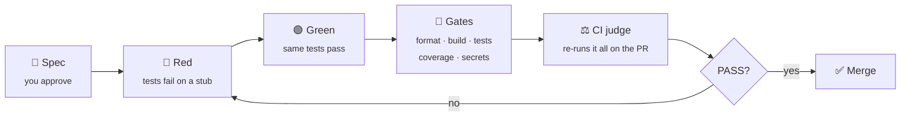

<div align="center">

<picture>
  <source media="(prefers-color-scheme: dark)" srcset="docs/assets/banner-dark.svg">
  
</picture>

### Test-first guardrails for AI coding agents on .NET

**Make Claude Code show its work.** New behaviour goes red → green, the build and tests can run before an agent says
"done", and a CI judge re-checks that evidence on every pull request.

[](https://github.com/lockflight/lockflight/actions/workflows/ci.yml)
[](https://www.nuget.org/packages/Lockflight.Cli)
[](https://www.nuget.org/packages/Lockflight.Cli)


[](LICENSE)

[**Quick start**](#quick-start) · [How it works](#how-it-works) · [Features](#features) · [Limits](#honest-about-its-limits) · [FAQ](#faq) ·
[Docs](docs/README.md) · [Changelog](CHANGELOG.md)

<br>


<sub>Real runs of <code>lockflight ci</code>, played back 2.5× faster.</sub>

</div>

## Why Lockflight?

Coding agents write code faster than anyone can review it. They can say *"all tests pass"* when nothing ran, edit the
config that was supposed to stop them, or write tests after the code, where they pass by construction.

Rules in `CLAUDE.md` ask an agent to behave. **Lockflight checks that it did**, with exit codes, not instructions. On your
machine they catch accidents; in CI, as a required check, they decide.

<table>
<tr>
<td width="33%" valign="top">

**🧪 Tests that fail first**

When a change adds behaviour, its new tests must fail at a red commit, inside production code, and pass unchanged at the
head. The judge re-runs both. A test committed with its implementation earns nothing.

</td>
<td width="33%" valign="top">

**🚦 "Done" means green**

Turn on the Stop gate (`stop.gate: true`) and it builds and tests before the agent's turn ends, sending it back on a failure.
It is best effort; CI is the definition of done.

</td>
<td width="33%" valign="top">

**🔒 Rules the agent shouldn't edit**

The guard blocks the agent's common edits to the policy, CI and build config, `echo … >> lockflight.yaml` included. CI
judges every pull request with the target branch's policy, so what slips past is still caught there.

</td>
</tr>
</table>

## Quick start

You need the [.NET 10 SDK](https://dotnet.microsoft.com/download) to install the engine. Your projects can target .NET 8, 9
or 10. On Windows, follow [install on Windows](docs/guides/getting-started.md#install-on-windows) instead of step 1. The CI
judge runs on GitHub-hosted Linux runners for now.

### With Claude Code (recommended)

```sh
# 1. The engine: one native binary for your user, outside any project
cd ~ && dotnet tool install Lockflight.Cli --tool-path ~/.lockflight/bin

# 2. The Claude Code plugin
claude plugin marketplace add lockflight/lockflight
claude plugin install lockflight@lockflight --scope user
```

Then open Claude Code in your repository and ask:

```text
> Set up Lockflight with the standard profile
```

The `lockflight:init` skill writes the policy (`lockflight.yaml`), pins the engine, adds the CI workflow and runs `doctor`.
The **lite** profile (the default) gives you the guard and the gates; **standard** adds the lifecycle. With standard, ask
*"build feature X"*: the agent writes a spec, you approve it with `/lockflight:approve`, and the work goes red → green story
by story. Set `stop.gate: true` in `lockflight.yaml` to turn on the Stop gate.

### CI only (any agent, or none)

No Claude Code needed. The GitHub Action judges every pull request, whoever or whatever wrote it:

```sh
~/.lockflight/bin/lockflight init --ci-only     # lockflight.yaml, the engine pin, .github/workflows/lockflight-gates.yml
git add -A && git commit -m "Set up Lockflight"
```

Then commit new tests with a stub first (`git commit --trailer "Lockflight-Red: 1"`) and the implementation after. The
**[Quickstart](QUICKSTART.md)** goes from an empty folder to a first `PASS` in about two minutes, every command included.

## How it works



1. **On your machine**, the Claude Code plugin keeps the agent on the path: the guard blocks common edits to protected files,
   the Stop gate (when on) runs the build and tests before a turn ends, and `redgreen red` records the failing tests as a red
   commit.
2. **In CI**, the judge takes the policy, baselines and engine version from the *target* branch, so a pull request can't
   change `lockflight.yaml`, the baselines or the engine it is judged with; build files and the workflow need CODEOWNERS
   ([CI hardening](docs/guides/ci-hardening.md)). It checks out each red commit, confirms the tests fail in production code,
   then confirms the same tests pass at the head.
3. **On the pull request**, you get two checks, `gates` and `lockflight/judge`, and a comment with the verdict. Make `gates`
   required from the start. Keep `lockflight/judge` advisory at first (its comment says what would block), and make it
   required once your team has run it on its own pull requests and seen its verdicts hold.

<picture>
  <source media="(prefers-color-scheme: dark)" srcset="docs/assets/ci-judge-dark.svg">
  
</picture>

## Features

### In Claude Code

<p align="center">
  
</p>

| | |
|---|---|
| **Guard** | A `PreToolUse` hook blocks the agent's common edits to the policy, CI, build config and tests while they are red, including through `sed`, `echo >>` and `cd`. Scripts and interpreters are not parsed: it is a guardrail. |
| **Stop gate** (opt-in) | With `stop.gate: true`, builds and tests before the agent's turn ends. A red test sends the agent back to work. |
| **Spec-driven lifecycle** | `/lockflight:feature` takes a feature through spec → plan → tasks → red/green per story → trace → review. [Spec Kit](https://github.com/github/spec-kit) is optional. |
| **Your approvals** | You approve the spec and the tasks with `/lockflight:approve`, one typed command. It records them as the agent's last turn left them; if they changed since, it shows them and records nothing until you type it again. The approval that counts is the pull request review, with CODEOWNERS on `specs/**`. |
| **Review of record** | An independent reviewer checks the diff against the spec. A blocking finding counts only when a failing test reproduces it. |
| **The crew** (optional) | A spec writer, a planner and a test author, each judged by the same checks as everyone else. |
| **Levi in the status line** | The last verdict at a glance, and a prompt when something waits for you. |

### In CI

| Check | What passes |
|---|---|
| **Red** | At each commit with a `Lockflight-Red` trailer, the new tests compile and fail because of production code. The judge re-runs that commit; the trailer is never trusted. |
| **Green** | At the head the same tests pass, nothing else fails beyond the accepted baseline, and no test was deleted or skipped. |
| **Tests since red** | Each test that went red is the same test at the head (compared by its compiled code), or an amended one still fails on the red commit. |
| **Trace** | With a spec, every requirement has a test that went red, then green, or a `[structural]` or `[outside .NET]` marker that a person accepts in review. |
| **Gates** | Format, build with no new warnings, tests, patch coverage, vulnerable packages and secrets. |
| **Risk routing** | The diff picks the evidence a PR needs: a typo fix needs less than a new API or a database change. [More](docs/guides/risk-routing.md) |
| **Host tampering** | A static scan for code in test assemblies that could forge a result: module initializers, process exits, setting CI variables and more. |

### Four verdicts

<table>
<tr>
<td align="center" width="25%"><br><code>PASS</code></td>
<td align="center" width="25%"><br><code>FAIL</code></td>
<td align="center" width="25%"><br><code>NOT-EARNED</code></td>
<td align="center" width="25%"><br><code>ERROR</code></td>
</tr>
<tr>
<td>Every required check passed.</td>
<td>A check ran and the code failed it: a test that passed before the code existed, a deleted test, a failing gate.</td>
<td>Nothing showed it, so it is never a pass: no red commit, a requirement without a test.</td>
<td>A tool broke. Not a verdict about the code.</td>
</tr>
</table>

## What it asks of you

- **A red commit in every pull request that adds behaviour,** humans and hotfixes included: the new tests with a stub,
  committed with a `Lockflight-Red: <n>` trailer before the implementation. With the plugin, `redgreen red` makes it; for a
  bug fix, `lockflight red` makes it from any terminal or IDE, with no spec ([fix a bug](docs/guides/fix-a-bug.md)); by hand,
  `git commit --trailer "Lockflight-Red: 1"`. Without one, `lockflight/judge` is `NOT-EARNED`.
- **A spec for a feature-class change** (a new API, a database change): `specs/<id>/spec.md`, by hand, with Spec Kit or with
  the crew ([the spec contract](docs/guides/spec-contract.md)).
- **CI time:** the judge builds and tests the fork point, every red commit and the head.
- **A plan that can block a merge:** required checks on a private GitHub repository need GitHub Pro, Team or Enterprise.

## Honest about its limits

- The judge makes faking test-first hard and visible. It does not prove the agent worked test-first, or that a test fully
  checks its requirement: a person still reads the test diff.
- The judge computes its evidence in the same job that runs the pull request's code. It is a strong guardrail, not a
  boundary; running that code isolated from the judge is planned.
- Everything on your machine (the guard, the Stop gate, local approvals) is a guardrail: the agent runs with your credentials.

Every control is labelled in [guardrails and boundaries](docs/guides/guardrails-and-boundaries.md).

## Why not just…

| | `CLAUDE.md` rules | Regular CI | **Lockflight** |
|---|:---:|:---:|:---:|
| Tells the agent to write tests first | ✅ | — | ✅ |
| Re-runs the tests on a commit without the implementation | — | — | ✅ |
| Blocks the agent's common edits to the rules (a guardrail) | — | — | ✅ |
| Runs build and tests before the agent says "done" (opt-in Stop gate) | — | — | ✅ |
| Checks every requirement has a test | — | — | ✅ |
| Blocks the merge when required | — | ✅ | ✅ |
| A PR can't weaken the checks that judge it | — | — | ✅¹ |

<sub>¹ With `lockflight/judge` required, and CODEOWNERS with required code-owner review on `lockflight.yaml`, `.lockflight/`, `.github/workflows/**`, `.github/actions/**` and build files ([CI hardening](docs/guides/ci-hardening.md)).</sub>

## Works with

- **.NET:** SDK-style projects on .NET 8, 9 and 10
- **Tests:** xUnit (v2 and v3), NUnit, MSTest
- **Your machine:** macOS, Linux and Windows; the engine is a Native AOT binary for each
- **Agents:** Claude Code with the plugin; any agent, or a person, with CI only

**The CI judge**, by CI service and runner:

| CI service | Runner | State |
|---|---|---|
| GitHub Actions | GitHub-hosted Linux x64 | supported |
| GitHub Actions | Windows | not yet: being added |
| GitHub Actions | macOS, Linux arm64 | not supported: gitleaks is downloaded for Linux x64 only |
| Bitbucket Pipelines | .NET SDK image (Linux x64) | the judge, from a template never run on a live workspace: unverified |
| GitLab CI/CD, Azure Pipelines | Linux x64 | the gates only, experimental: unverified on the live services (Azure not run at all) |

The full matrix is in [CI on other platforms](docs/guides/ci-other-platforms.md#platforms-and-runners).

## FAQ

<details>
<summary><b>Do I need Claude Code?</b></summary>

No. `init --ci-only` sets up only the CI judge. It judges pull requests from any agent (Copilot, Cursor, Codex…) or from
people. The plugin adds the local loop for Claude Code: the guard, the Stop gate and the lifecycle. The judge needs a red commit
from whoever writes the code: `lockflight red` checks and commits it from any terminal or IDE, and
`git commit --trailer "Lockflight-Red: 1"` works too.
</details>

<details>
<summary><b>Do I need an API key?</b></summary>

No. The judge and the gates run without one. Only the optional review of record calls a model; with the default preset,
critical changes (the policy, build-wide files, a new project) need that review. The review job runs the pull request's
code, which can read the key: use a spend-capped key. Pull requests from forks get no review.
</details>

<details>
<summary><b>My repository already has failing tests or warnings.</b></summary>

Put them in a baseline: Lockflight then judges only what each pull request changes. See
[CI hardening](docs/guides/ci-hardening.md).
</details>

<details>
<summary><b>Can't the agent just get around it?</b></summary>

On your machine, the agent runs with your credentials, so the guard catches accidents and common workarounds, not a
determined attacker. The CI judge is the verdict of record: it takes its policy and engine from the target branch, so as a
required check, with CODEOWNERS on the policy and the workflow, a pull request can't change the policy or engine that judge
it. The test results come from running its code, so deliberate code in the diff could forge them; the host-tampering scan
lists the plain forms, and a person still reads the tests. Every control is labelled in
[guardrails and boundaries](docs/guides/guardrails-and-boundaries.md).
</details>

<details>
<summary><b>Does it work with Spec Kit?</b></summary>

Yes. Lockflight ships a Spec Kit preset, and `init` adopts an existing Claude Code or Spec Kit setup. Spec Kit is optional:
the crew or you can write the spec by hand ([the spec contract](docs/guides/spec-contract.md)).
</details>

<details>
<summary><b>What does it cost?</b></summary>

Lockflight is free and MIT-licensed. CI time grows with the number of red commits, because the judge builds and tests each one.
</details>

## Status

**Alpha.** The engine has thousands of unit tests and end-to-end suites on macOS, Linux and Windows. Expect rough edges; [the changelog](CHANGELOG.md) says what changed and how to upgrade.

## Documentation

| | |
|---|---|
| 🚀 [Quickstart](QUICKSTART.md) | A first `PASS` from the CI judge, in about two minutes |
| 🧭 [Getting started](docs/guides/getting-started.md) | Set up your own repository |
| 🧩 [Install levels](docs/guides/install-levels.md) | CI only, CI + native settings, or CI + plugin |
| 🛡️ [CI hardening](docs/guides/ci-hardening.md) | Make the judge the check of record |
| ⌨️ [Commands](docs/guides/commands.md) · [Skills](docs/guides/skills.md) | Every command and `/lockflight:*` skill |
| ⚙️ [Configuration](docs/guides/configuration.md) | Everything in `lockflight.yaml` |
| 🔍 [How it works](docs/architecture.md) | The parts and where the trust comes from |

## Contributing

Questions and ideas go to [Discussions](https://github.com/lockflight/lockflight/discussions), bugs to
[Issues](https://github.com/lockflight/lockflight/issues/new/choose), and a way around a control to
[private reporting](SECURITY.md). Pull requests are welcome: see [CONTRIBUTING](CONTRIBUTING.md).

If Lockflight keeps your agent honest, **[give it a ⭐](https://github.com/lockflight/lockflight)** so other .NET teams can
find it.

## License

[MIT](LICENSE). Levi keeps the lock.
