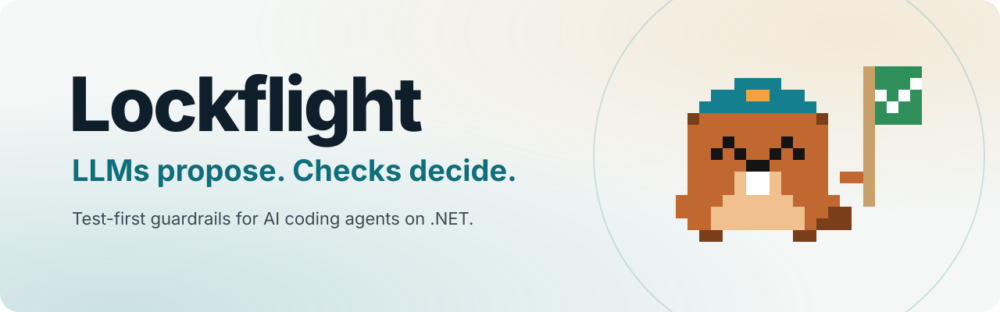
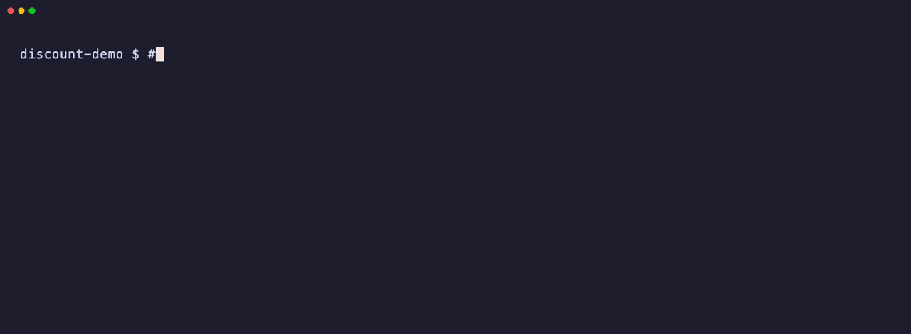
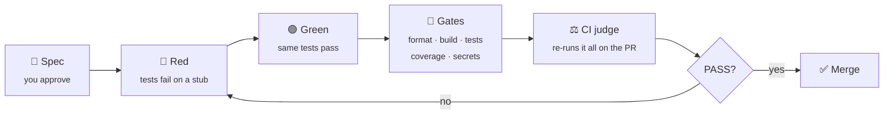

<div align="center">

<picture>
  <source media="(prefers-color-scheme: dark)" srcset="docs/assets/banner-dark.svg">
  
</picture>

### Test-first guardrails for AI coding agents on .NET

**Make Claude Code prove its work.** Lockflight makes every change go red → green, runs the build and tests before an agent
can say "done", and re-checks that evidence in CI on every pull request.

[](https://github.com/lockflight/lockflight/actions/workflows/ci.yml)
[](https://www.nuget.org/packages/Lockflight.Cli)
[](https://www.nuget.org/packages/Lockflight.Cli)


[](LICENSE)

[**Quick start**](#quick-start) · [How it works](#how-it-works) · [Features](#features) · [FAQ](#faq) ·
[Docs](docs/README.md) · [Changelog](CHANGELOG.md)

<br>


<sub>Real runs of <code>lockflight ci</code>, played back 2.5× faster.</sub>

</div>

## Why Lockflight?

Coding agents write code faster than anyone can review it. They also say *"all tests pass"* when nothing ran, edit the
config that was supposed to stop them, and write tests after the code, where they pass by construction.

Rules in `CLAUDE.md` ask an agent to behave. **Lockflight checks that it did**, with exit codes it cannot talk its way past.

<table>
<tr>
<td width="33%" valign="top">

**🧪 Tests come first, provably**

Every new test must fail on a stub before the implementation exists, then pass unchanged after it. The judge re-runs both
commits itself, so a test written after the code is caught.

</td>
<td width="33%" valign="top">

**🚦 "Done" means green**

Before an agent's turn can end, the Stop gate builds and tests. A failing test keeps the agent working instead of reporting
success.

</td>
<td width="33%" valign="top">

**🔒 Rules the agent can't edit**

The policy, CI workflow, build config and red tests are protected. An `echo … >> lockflight.yaml` from the agent is blocked
before it runs.

</td>
</tr>
</table>

## Quick start

You need the [.NET 10 SDK](https://dotnet.microsoft.com/download) to install the engine. Your projects can target .NET 8, 9
or 10. On Windows, follow [install on Windows](docs/guides/getting-started.md#install-on-windows) instead of step 1.

### With Claude Code (recommended)

```sh
# 1. The engine: one native binary for your user, outside any project
cd ~ && dotnet tool install Lockflight.Cli --tool-path ~/.lockflight/bin

# 2. The Claude Code plugin
claude plugin marketplace add lockflight/lockflight
claude plugin install lockflight@lockflight --scope user
```

Then open Claude Code in your repository and ask:

```text
> Set up Lockflight
```

The `lockflight:init` skill writes the policy (`lockflight.yaml`), pins the engine, adds the CI workflow and runs `doctor`.
To build something, ask *"build feature X"*: the agent writes a spec, you approve it with `/lockflight:approve`, and the
work goes red → green story by story.

### CI only (any agent, or none)

No Claude Code needed. The GitHub Action judges every pull request, whoever or whatever wrote it:

```sh
~/.lockflight/bin/lockflight init --ci-only     # lockflight.yaml, the engine pin, .github/workflows/lockflight-gates.yml
git add -A && git commit -m "Set up Lockflight"
```

Then commit new tests with a stub first (`git commit --trailer "Lockflight-Red: 1"`) and the implementation after. The
**[Quickstart](QUICKSTART.md)** goes from an empty folder to a first `PASS` in about two minutes, every command included.

## How it works



1. **On your machine**, the Claude Code plugin keeps the agent on the path: the guard blocks edits to protected files, the
   Stop gate runs the build and tests before a turn ends, and `redgreen red` records the failing tests as a red commit.
2. **In CI**, the judge takes the policy and engine version from the *target* branch, so a pull request can't loosen the rules
   that judge it. It checks out each red commit, confirms the tests fail in production code, then confirms the same tests
   pass at the head.
3. **On the pull request**, you get two checks, `gates` and `lockflight/judge`, and a comment with the verdict.

<picture>
  <source media="(prefers-color-scheme: dark)" srcset="docs/assets/ci-judge-dark.svg">
  
</picture>

## Features

### In Claude Code

<p align="center">
  
</p>

| | |
|---|---|
| **Guard** | A `PreToolUse` hook blocks the agent's edits to the policy, CI, build config and tests while they are red, including through `sed`, `echo >>` and `cd`. |
| **Stop gate** | Builds and tests before the agent's turn can end. A red test means the agent keeps working. |
| **Spec-driven lifecycle** | `/lockflight:feature` takes a feature through spec → plan → tasks → red/green per story → trace → review. [Spec Kit](https://github.com/github/spec-kit) is optional. |
| **Your approvals** | You approve the spec and the tasks with `/lockflight:approve`, one typed command. It records the files exactly as they were when you read them. |
| **Review of record** | An independent reviewer checks the diff against the spec. A blocking finding counts only when a failing test reproduces it. |
| **The crew** (optional) | A spec writer, a planner and a test author, each judged by the same checks as everyone else. |
| **Levi in the status line** | The last verdict at a glance, and a prompt when something waits for you. |

### In CI

| Check | What passes |
|---|---|
| **Red** | At each commit with a `Lockflight-Red` trailer, the new tests compile and fail because of production code. The judge re-runs that commit; the trailer is never trusted. |
| **Green** | At the head the same tests pass, nothing else fails beyond the accepted baseline, and no test was deleted or skipped. |
| **Tests since red** | Each test that went red is the same test at the head (compared by its compiled code), or an amended one still fails on the red commit. |
| **Trace** | With a spec, every requirement has a test that went red, then green. |
| **Gates** | Format, build with no new warnings, tests, patch coverage, vulnerable packages and secrets. |
| **Risk routing** | The diff picks the evidence a PR needs: a typo fix needs less than a new API or a database change. [More](docs/guides/risk-routing.md) |
| **Host tampering** | A static scan for code in test assemblies that could forge a result: module initializers, process exits, setting CI variables and more. |

### Four verdicts

<table>
<tr>
<td align="center" width="25%"><br><code>PASS</code></td>
<td align="center" width="25%"><br><code>FAIL</code></td>
<td align="center" width="25%"><br><code>NOT-EARNED</code></td>
<td align="center" width="25%"><br><code>ERROR</code></td>
</tr>
<tr>
<td>Every required check passed.</td>
<td>A check ran and the code failed it: a test that passed before the code existed, a deleted test, a failing gate.</td>
<td>Nothing showed it, so it is never a pass: no red commit, a requirement without a test.</td>
<td>A tool broke. Not a verdict about the code.</td>
</tr>
</table>

## Why not just…

| | `CLAUDE.md` rules | Regular CI | **Lockflight** |
|---|:---:|:---:|:---:|
| Tells the agent to write tests first | ✅ | — | ✅ |
| Proves the tests failed before the code existed | — | — | ✅ |
| Stops the agent from editing the rules | — | — | ✅ |
| Runs build and tests before the agent says "done" | — | — | ✅ |
| Checks every requirement has a test | — | — | ✅ |
| Blocks the merge | — | ✅ | ✅ |
| A PR can't weaken the checks that judge it | — | — | ✅¹ |

<sub>¹ With `lockflight/judge` as a required check and the policy and workflow under CODEOWNERS ([CI hardening](docs/guides/ci-hardening.md)).</sub>

## Works with

- **.NET:** SDK-style projects on .NET 8, 9 and 10
- **Tests:** xUnit (v2 and v3), NUnit, MSTest
- **OS:** macOS, Linux and Windows; the engine is a Native AOT binary for each
- **CI:** GitHub Actions; Bitbucket Pipelines (template); GitLab and Azure Pipelines (gates only, experimental)
- **Agents:** Claude Code with the plugin; any agent, or a person, with CI only

## FAQ

<details>
<summary><b>Do I need Claude Code?</b></summary>

No. `init --ci-only` sets up only the CI judge. It judges pull requests from any agent (Copilot, Cursor, Codex…) or from
people. The plugin adds the local loop for Claude Code: the guard, the Stop gate and the lifecycle.
</details>

<details>
<summary><b>Do I need an API key?</b></summary>

No. The judge and the gates run without one. Only the optional review of record calls a model; with the default preset,
critical changes (the policy, build-wide files, a new project) need that review.
</details>

<details>
<summary><b>My repository already has failing tests or warnings.</b></summary>

Put them in a baseline: Lockflight then judges only what each pull request changes. See
[CI hardening](docs/guides/ci-hardening.md).
</details>

<details>
<summary><b>Can't the agent just get around it?</b></summary>

On your machine, the agent runs with your credentials, so the guard catches accidents and common workarounds, not a
determined attacker. The CI judge is the verdict of record: it takes its policy from the target branch and, as a required
check with CODEOWNERS on the policy, the pull request can't change what judges it. A test can still check too little: a
person still reads the tests. Every control is labelled in [guardrails and boundaries](docs/guides/guardrails-and-boundaries.md).
</details>

<details>
<summary><b>Does it work with Spec Kit?</b></summary>

Yes. Lockflight ships a Spec Kit preset, and `init` adopts an existing Claude Code or Spec Kit setup. Spec Kit is optional:
the crew or you can write the spec by hand ([the spec contract](docs/guides/spec-contract.md)).
</details>

<details>
<summary><b>What does it cost?</b></summary>

Lockflight is free and MIT-licensed. CI time grows with the number of red commits, because the judge builds and tests each one.
</details>

## Status

**Alpha.** The engine has thousands of unit tests and end-to-end suites on macOS, Linux and Windows, and Lockflight is built
with its own lifecycle. Expect rough edges; [the changelog](CHANGELOG.md) says what changed and how to upgrade.

## Documentation

| | |
|---|---|
| 🚀 [Quickstart](QUICKSTART.md) | A first `PASS` from the CI judge, in about two minutes |
| 🧭 [Getting started](docs/guides/getting-started.md) | Set up your own repository |
| 🧩 [Install levels](docs/guides/install-levels.md) | CI only, CI + native settings, or CI + plugin |
| 🛡️ [CI hardening](docs/guides/ci-hardening.md) | Make the judge the check of record |
| ⌨️ [Commands](docs/guides/commands.md) · [Skills](docs/guides/skills.md) | Every command and `/lockflight:*` skill |
| ⚙️ [Configuration](docs/guides/configuration.md) | Everything in `lockflight.yaml` |
| 🔍 [How it works](docs/architecture.md) | The parts and where the trust comes from |

## Contributing

Questions and ideas go to [Discussions](https://github.com/lockflight/lockflight/discussions), bugs to
[Issues](https://github.com/lockflight/lockflight/issues/new/choose), and a way around a control to
[private reporting](SECURITY.md). Pull requests are welcome: see [CONTRIBUTING](CONTRIBUTING.md).

If Lockflight keeps your agent honest, **[give it a ⭐](https://github.com/lockflight/lockflight)** so other .NET teams can
find it.

## License

[MIT](LICENSE). Built with its own lifecycle; Levi keeps the lock.
