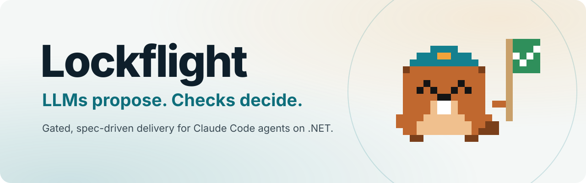

<div align="center">

<picture>
  <source media="(prefers-color-scheme: dark)" srcset="docs/assets/banner-dark.svg">
  
</picture>

[](https://github.com/lockflight/lockflight/actions/workflows/ci.yml)
[](https://www.nuget.org/packages/Lockflight.Cli)


[](LICENSE)

[Quick start](#quick-start) · [How it works](#how-a-change-rises) · [Why](#instructions-vs-checks) ·
[What it guarantees](docs/guides/guardrails-and-boundaries.md) · [Docs](docs/README.md)

</div>

**Coding agents write code faster than anyone can review it.** The bottleneck moved from writing code to trusting it. Rules
in `CLAUDE.md`, skills and reviewer agents are instructions, and an agent can talk its way past a paragraph.
**It can't talk its way past an exit code.**

| "Done" isn't evidence | Rules are optional | Tests come last |
|---|---|---|
| The agent says the build is green. Did anything actually run? | "Don't touch the config," says the skill. One `sed` later, it's touched. | Tests written after the code pass by construction and prove little. |

> [!TIP]
> **Lockflight turns your process into checks.** One pinned engine judges every step: in the Claude Code session, in your
> terminal and in CI. Same input, same verdict.

<p align="center">
  
</p>

## How a change rises

Like a boat in a canal lock flight, a change climbs stage by stage. Each gate opens only when its check passes, and you
hold the keys to the two that need a person.

<picture>
  <source media="(prefers-color-scheme: dark)" srcset="docs/assets/lock-flight-dark.svg">
  
</picture>

## Instructions vs checks

| | Skills, agents and Spec Kit alone | With Lockflight |
|---|---|---|
| **Protected config** | "Please don't edit" in `CLAUDE.md` | The guard blocks the edit, shell writes included |
| **"Tests pass"** | The agent's word | The Stop gate builds and tests before the turn can end |
| **Test-first** | A habit, when remembered | Red/green evidence: new tests fail first, then pass |
| **Spec to code** | A sequence the agent may skip | Hash-bound approvals and phase checks between steps |
| **Coverage of the spec** | Unknown | A trace: every requirement and the tests that prove it |
| **Review** | A reviewer briefed by the coding agent | An independent reviewer; blocking findings need a failing test |
| **CI** | Config a pull request can loosen | The same engine, with the base branch's policy |

## What's in the box

| | |
|---|---|
| **Deterministic gates**<br>Format, build with no new warnings, tests, patch coverage, vulnerable packages, secrets. `PASS`, `FAIL` or `NOT-EARNED`, never "probably". | **Protected paths**<br>The files that define the rules can't be changed by the agent, through edits or the shell ([full list](docs/guides/configuration.md#built-in-protected-paths)). |
| **Spec-driven, on [Spec Kit](https://github.com/github/spec-kit)**<br>A preset, not a fork: requirement IDs, approvals you sign, checks between phases. | **Red/green evidence**<br>New tests must fail before the code exists and pass after, locked while red. xUnit v3 and v2. |
| **Requirement trace**<br>A matrix of every requirement and the tests that went red, then green, for it. | **Evidence-bound review**<br>An independent reviewer whose blocking findings count only with a failing reproduction test. |
| **Adopts your setup**<br>Keeps your hooks, skills, agents and Spec Kit, protects them and flags conflicts. `adopt undo` reverts it. | **One repo or twenty**<br>Workspace shells with service repositories beneath: only changed services are built, and each keeps its own CI policy. |

<table>
<tr>
<td width="140" align="center"></td>
<td><b>Meet Levi.</b> The lock-keeper shows each verdict in your terminal and, if you like, in Claude Code's status line:
a green flag for <code>PASS</code>, a question for <code>NOT-EARNED</code>, a red flag for <code>FAIL</code>, and the barrier
when the guard says no. Only you see him: he stays out of anything the agent reads, so he costs no tokens.</td>
</tr>
</table>

<p align="center">
  &nbsp;&nbsp;
  &nbsp;&nbsp;
  &nbsp;&nbsp;
  
</p>

## Quick start

**Requirements**

- **macOS (Apple silicon or Intel), Linux (x64 or arm64), or Windows (x64) with Git for Windows** (Git Bash runs the hooks).
  On Windows install with `scripts\dev-install.ps1`: see [Install on Windows](docs/guides/getting-started.md#install-on-windows).
- **The .NET 10 SDK** for the engine, plus the SDK your project needs; git.
- **An SDK-style .NET 8, 9 or 10 project.** xUnit v3 (Microsoft.Testing.Platform) gets everything; xUnit v2 (VSTest) is
  supported; NUnit and MSTest get the gates only, no red/green or trace yet. .NET Framework projects are not supported.
- **Claude Code 2.1.295 or newer.**
- **[gitleaks](https://github.com/gitleaks/gitleaks)** on `PATH` for the secrets step of the `pr` profile.
- For the standard profile: `uv` and Python 3 with PyYAML (Spec Kit).

**1. Install the engine and the plugin**

```sh
cd ~                          # outside any project: a global.json there could pick an SDK older than 10
dotnet tool install Lockflight.Cli --prerelease --tool-path ~/.lockflight/bin
claude plugin marketplace add lockflight/lockflight
claude plugin install lockflight@lockflight --scope user
```

To build from a checkout instead, run `scripts/dev-install.sh` in a clone of this repository
([install from source](docs/guides/getting-started.md#install-from-source)).

**2. Set up your repository**

```sh
cd /path/to/your/repo
~/.lockflight/bin/lockflight init       # or: init --profile standard
.lockflight/bin/lockflight doctor       # the engine init linked into the project, as the agent runs it
```

Or ask Claude Code, started at the repository root: *"Set up Lockflight"*. `init` writes `lockflight.yaml`, the engine pin in
`dotnet-tools.json`, `.gitignore` entries, the plugin in `.claude/settings.json`, a CI workflow
(`.github/workflows/lockflight-gates.yml`) and the linked engine in `.lockflight/bin/` (git-ignored). It merges into files
that exist and never overwrites them.

**3. Commit, and start Claude Code at the root**

The guard is on, and `.lockflight/bin/lockflight gate run` runs format → build → tests. You're gated. The
[getting-started guide](docs/guides/getting-started.md) covers the profiles (`lite` for gates and guard, `standard` for the
full lifecycle), monorepos, workspace shells and the status line.

**Already have a Claude Code or Spec Kit setup?** Only then: `.lockflight/bin/lockflight adopt plan` writes a plan of what it
keeps, protects and flags, and ends with the exact `adopt apply` line. Approvals and adoption are yours to run, in a separate
terminal window: the engine refuses them inside an agent session, a `!` command in Claude Code included. Apply backs up
first, and `adopt undo` reverts it.

> [!NOTE]
> **Preview.** `Lockflight.Cli` is published on nuget.org as a prerelease (`--prerelease` above); the design can still change
> between releases. An engine built from source is a development build that no package feed has, so a project that pins one
> gets a CI workflow that runs only when started by hand until it pins a release
> ([CI with a development build](docs/guides/getting-started.md#ci-with-a-development-build)).

## Honest about its limits

| Guardrail, on your machine | Boundary, where the agent can't reach |
|---|---|
| The agent runs with your credentials. The guard and the Stop gate prevent accidents and make the right path the easy one. | CI with the base branch's policy, as a required check. Signed approvals can be one too. |

Every control is labelled one or the other: [guardrails and boundaries](docs/guides/guardrails-and-boundaries.md),
[CI hardening](docs/guides/ci-hardening.md).

## Status

**Alpha, in daily use on real projects.** The engine has over 900 unit tests; end-to-end suites cover the lifecycle and
workspace shells on Linux, macOS and Windows, including attempts to get around the controls. Hooks run the linked engine
directly, without `dotnet`, so a hook call costs milliseconds; [`tests/compat/run-windows.ps1`](tests/compat/run-windows.ps1)
measures it (p50 and p95 over 200 calls).

**Docs:** [getting started](docs/guides/getting-started.md) · [commands](docs/guides/commands.md) ·
[configuration](docs/guides/configuration.md) · [how it works](docs/architecture.md)

## Contributing

Questions, ideas and stories of how you use Lockflight go to
[Discussions](https://github.com/lockflight/lockflight/discussions); bugs go to
[Issues](https://github.com/lockflight/lockflight/issues/new/choose); a way around a control goes to
[private reporting](SECURITY.md). Pull requests are welcome: see [CONTRIBUTING](CONTRIBUTING.md), and before you propose a
design change, read [how it works](docs/architecture.md). C# follows the [code style](docs/engineering/code-style.md).

```sh
cd engine && dotnet build && dotnet test                     # engine
ENGINE=<built lockflight> bash tests/e2e/lifecycle.sh <dir>   # lifecycle end to end
```

## License

[MIT](LICENSE). Built with its own lifecycle; Levi keeps the lock.
