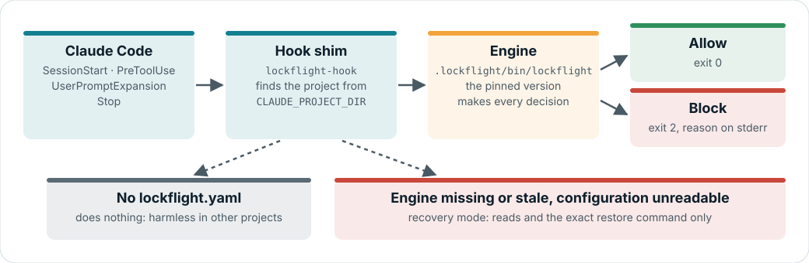

# How Lockflight works

Lockflight turns a delivery process into checks with exit codes: LLMs propose, checks decide. The verdict of record is a CI
check on the pull request, run under the base branch's policy; what runs on a developer's machine is an assistant on the same
contract. This page explains the parts and how they fit together, for anyone who wants to understand the design or change it. For what each command and setting does, see
[commands](guides/commands.md) and [configuration](guides/configuration.md); for what each control can and cannot guarantee,
see [guardrails and boundaries](guides/guardrails-and-boundaries.md).

**On this page:** [Principles](#principles) · [The parts](#the-parts) · [The CI judge](#the-ci-judge) ·
[The engine on every hook call](#the-engine-on-every-hook-call) · [The guard](#the-guard) · [Gates](#gates) ·
[The lifecycle](#the-lifecycle-standard-profile) · [Topologies](#topologies) · [Adoption](#adoption) ·
[The ledger](#the-ledger) · [Where the trust comes from](#where-the-trust-comes-from) ·
[Extending the engine](#extending-the-engine)

## Principles

1. **Deterministic where measurable.** If a question can be answered by a command with an exit code, it is. LLM judgment sits
   on top of green commands, never in place of them.
2. **One engine, one policy, one verdict.** The same pinned engine judges in the Claude Code session, in your terminal and in
   CI. The same inputs give the same verdict.
3. **Layers, never one alone.** Routed instructions (`CLAUDE.md`, skills) are a cheap first line; hooks make the engine decide
   on the agent's machine; CI with the base branch's policy decides where the agent can't reach.
4. **Three-valued verdicts.** `PASS`, `FAIL` or `NOT-EARNED`. A check that had nothing to judge (zero tests, a build that
   didn't run) is never a pass.
5. **Humans approve intent, not commands.** People approve the spec and the tasks and merge the pull request; everything in
   between is judged by checks, without per-command prompts.
6. **Honest labels.** Every control is a guardrail (prevents accidents, on your machine) or a boundary (holds against a
   determined agent). Nothing is called enforced unless something outside the agent's reach enforces it.
7. **The judge gives facts and verdicts; the crew gives advice.** Anything that decides a verdict or records a fact lives in
   the engine. Anything that suggests, authors or summarises is an optional crew agent or skill.

## The parts

```text
 Claude Code session                 Your terminal                     CI (pull request)
 the local assistant: plugin or      human-only commands               the judge of record:
 native hooks (or nothing)                                             lockflight ci, base policy
        │                                   │                                 │
        └─────────── lockflight engine (pinned by the repository) ────────────┘
             CI judge · risk routing · gates · guard · lifecycle · trace · review · ledger
                                            │
                       project: lockflight.yaml · .lockflight/ · specs/ · .claude/
```

| Part | What it is | Where |
|---|---|---|
| **Engine** | A C# Native AOT command-line tool, `lockflight`. All decisions are made here. | [`engine/`](../engine/) |
| **Plugin** | The local assistant: Claude Code skills (`/lockflight:*`) and hooks that call the engine. It holds no policy of its own and is never of record. It is one of three [install levels](guides/install-levels.md); the others are CI only and CI with Claude Code's native settings. | [`plugins/lockflight/`](../plugins/lockflight/) |
| **Crew (optional)** | A second plugin with agents briefed for the lifecycle: a spec writer, a planner and a test author. Each runs an engine check as its verdict; none is a judge. | [`plugins/lockflight-crew/`](../plugins/lockflight-crew/) |
| **Spec Kit preset (optional)** | Templates and commands layered over [Spec Kit](https://github.com/github/spec-kit) so that its output follows the [spec contract](guides/spec-contract.md): requirement IDs, test-first tasks. A preset, not a fork. | [`plugins/lockflight/speckit-preset/`](../plugins/lockflight/speckit-preset/) |
| **Project files** | `lockflight.yaml` (the policy, version 2, with a published [JSON Schema](../lockflight.schema.json)), the engine pin (`.lockflight/engine.lock`, the version and SHA-256 per platform, with the version also in `dotnet-tools.json` during 0.3), `.lockflight/` (approvals, evidence, baselines, ledger), the CI workflow. | your repository |

## The CI judge

`lockflight ci` is the judge of record. It reads the policy from the target branch with `git show`, never from the pull
request's `lockflight.yaml`, and judges the pull request's commits:

- **Red commits.** Each commit with a `Lockflight-Red: <cycle>` trailer is re-run in a worktree outside the checkout. The
  trailer is never trusted: the tests new at that commit must compile and fail inside production code (`RED_STUB` or
  `RED_ASSERT`), as `redgreen red` classifies them locally.
- **Green at head.** The same tests pass at head, with no other failures beyond the base's known-failing baseline, and a
  per-method fingerprint shows whether each cycle test changed since its red.
- **Changed tests and host tampering.** Existing tests the pull request changed are re-checked (advisory for now), and code
  in test assemblies that could tamper with the test host is listed.
- **Change class.** Today the judge uses an interim classification from git (low-risk paths, dependency-only changes,
  everything else a behaviour change). In 0.3.0 it moves to [risk routing](guides/risk-routing.md), which computes a class
  from the diff (`fix`, `behaviour`, `feature`, `critical`) under the base branch's thresholds (`lockflight route show`);
  the class then sets what the pull request must prove. A class can be raised, never lowered.

Trace, the gates, the report and a review in a separate job with an API key, the GitHub Action and the CI templates that run
the judge are being added in 0.3.0; until they land, the generated workflow runs the `pr` gates. The judge reports under two
status contexts: `gates` (the `pr` gates and green at head) and `lockflight/judge` (the rest), so a team can make the full
verdict required when it is ready. Every step is listed in [commands](guides/commands.md).

The judge runs the pull request's code in its own job. That code (a test, production code, a build file) could therefore
forge the results, with deliberate code in the pull request's diff; the host-tampering check lists the plain forms, and an
obfuscated one evades it. So the red/green verdict is a **strong guardrail, not a boundary**. What a pull request cannot
change is the policy, the engine lock and CODEOWNERS, read from the base branch. The check itself is a boundary only where the
platform enforces it: a required check whose workflow files are under CODEOWNERS with required review, or a workflow a
ruleset requires ([CI hardening](guides/ci-hardening.md)).

## The engine on every hook call

The plugin registers five hooks: `SessionStart`, `PreToolUse`, `UserPromptExpansion`, `TaskCompleted` and `Stop`. Each runs a small shim,
[`lockflight-hook`](../plugins/lockflight/bin/lockflight-hook), which finds the project from `CLAUDE_PROJECT_DIR` and runs the
engine linked into `.lockflight/bin/`. Running the binary directly keeps a hook at a few milliseconds.

<picture>
  <source media="(prefers-color-scheme: dark)" srcset="assets/hook-flow-dark.svg">
  
</picture>

The shim has three states:

- **No `lockflight.yaml`:** it does nothing, so the plugin is harmless in other projects.
- **Linked engine of the pinned version:** it runs it, unless the binary is committed to the repository, belongs to
  another user, or differs from the SHA-256 `link` recorded beside it, or has no such record; then it treats the engine as missing
  and says how to fix it (for an engine without a record, also at session start).
- **Engine missing, stale or unreadable configuration:** recovery mode. Reads and the exact restore command are allowed;
  everything else is blocked with the fix.

Inside the engine, a hook call is a client-neutral request (`lockflight.hook-request/v1`): the tool's **kind** (`read`,
`search`, `edit`, `write`, `shell` with its dialect, `notebook`, `fetch`, `agent`, `other`), whether it writes the files it
names, those paths, the command, the session and the working directory. The Claude Code adapter
(`Hooks/Adapters/ClaudeCodeAdapter.cs`) translates Claude Code's payload into it, and the guard decides on kinds, never on tool
names: an unknown tool is `other` and is judged like any unknown tool, and one whose input names a file path (an MCP tool's
`path`) is guarded as a file write. `LOCKFLIGHT_HOOK_ADAPTER` picks the adapter (unset: Claude Code); it is never a
command-line argument, because an older engine refuses any argument after `hook <event>`. `neutral` reads the request JSON
itself, for tests and outside adapters. The request format is experimental, not a frozen contract, until a second client's
adapter exists. The shim keeps Claude Code's names for its own recovery decisions, and a test keeps them in sync with the
adapter's table.

The contract with Claude Code: a block is **exit 2 with the reason on stderr**; structured answers go to stdout as JSON.
`PreToolUse` is registered with `onFailure: "block"`, so a guard that cannot start blocks rather than allows. Claude Code does
not offer that for `Stop`, which is why the Stop gate is best effort and CI is the definition of done.

`UserPromptExpansion` fires when a prompt expands a slash command, never for the agent's own skill calls. Claude Code's
documentation says it runs for a user-typed command, but a live probe showed it also fires, with the same payload, for a prompt
that a `CronCreate` task queued; the relay guard (see [guardrails and
boundaries](guides/guardrails-and-boundaries.md#every-control-labelled)) exists for that case, and the probe is repeated before
each Lockflight release. The engine ignores every command except the in-session human commands (`/lockflight:approve`,
`/lockflight:baseline`, `/lockflight:reset`, `/lockflight:amend`), which it handles only in an interactive, attended session:
it shows the person (on stderr with exit 2, which the agent does not see) what would be recorded with a one-time code, and
records the decision when the person types that code while what they were shown is unchanged.

## The guard

`PreToolUse` sends every tool call to the guard. It canonicalises each path it can see (separators, case, drive letters,
symbolic links, Windows short names and alternate streams) and blocks writes to protected paths: `lockflight.yaml`, the tool
pin, `.lockflight/**`, Claude Code settings, the team's `.claude/` hooks, agents, skills and commands, .NET build and analyzer
policy, package sources, the CI job, the paths the manifest adds, and the test projects while a red/green cycle is open (the
[full list](guides/configuration.md#built-in-protected-paths)). Shell commands are parsed for the common writes only (redirections,
`tee`, copies and moves, in-place editors, `rm`, `git checkout`/`restore`/`apply`, `dotnet format`, the PowerShell
equivalents) to catch accidents; a command whose writes the guard does not parse (a script, an interpreter, a pipeline into
`xargs`) is allowed, and the test files' red-time hashes and CI catch what it misses. Agent worktrees under
`.claude/worktrees/` get the same rules.

`init` also lists the protected paths that exist as write denials for the Claude Code sandbox, so that while the sandbox is
on the operating system refuses a shell command's write to them however the command hides it
([the Claude Code sandbox](guides/guardrails-and-boundaries.md#the-claude-code-sandbox)).

The guard is a guardrail: the agent runs with your credentials. The boundary for the same files is CI, which reads the policy
from the base branch and fails a pull request that changes protected files without a person's review.

## Gates

A gate run executes the steps of a profile in order and ends in one verdict:

| Profile | When | Typical steps |
|---|---|---|
| `edit` | after a change, cheap | format of the changed lines |
| `stop` | before the agent's turn ends | format, build with no new warnings, tests |
| `pr` | in CI, and before a pull request | protected changes, the `stop` steps, patch coverage, vulnerable packages, secrets |

Each step normalises its tool's output instead of trusting the exit code alone (for example `dotnet package list --vulnerable`
exits 0 with findings). Existing problems in a brownfield repository are accepted once, by a person, as baselines, so gates
judge new problems only. Patch coverage judges the changed lines against the base branch, with test code excluded.

The Stop gate runs the `stop` profile when the agent tries to end its turn. It is cached by a hash of its inputs, so an
unchanged tree is not rebuilt, and its block message names the failing tests. In a workspace it builds and tests only the
units that changed since their last PASS: uncommitted changes, a commit, or a shared build input outside every unit.
`lockflight gate run` of the `stop` profile over the stop target caches its PASS the same way.

With the Stop gate on, the `TaskCompleted` hook lets a task be marked completed only when that cache holds a PASS for the tree
as it is now. It reads that evidence and never builds, so it answers within its 30 s timeout. When the Stop gate already sent
the same tree back in this session, it does not block again: the agent is already fixing it, and the Stop gate judges the tree
again before the turn ends. Like the Stop gate it is best effort. Claude Code lets the task complete when the hook fails or
times out, because only exit 2 blocks.

## The lifecycle (standard profile)

```text
spec ──approve──▶ plan + tasks ──approve──▶ red ──▶ green ──▶ trace ──▶ review ──▶ pull request
```

- **Phase checks** (`phase check specify|tasks`) verify structure deterministically: unique requirement IDs, no open
  clarifications, every requirement covered by a task, tests before implementation. An approval runs the matching check first
  and records nothing while it fails. The format they read is a public contract ([the spec contract](guides/spec-contract.md)):
  the crew's spec writer and planner, Spec Kit with the preset, or a person can write it.
- **Approvals** bind the SHA-256 of the approved files to a person. Any later edit makes the approval stale, and the steps that
  depend on it refuse to run. They are the local loop's records; the approval of record is the platform's review of the pull request, with CODEOWNERS on
  `specs/**`.
- **Red/green.** The plan declares new signatures; stubs throw `NotImplementedException`. `redgreen red` accepts a cycle only
  when every new test fails because of production code: a stub's `NotImplementedException` thrown from production code
  (`RED_STUB`), or an assertion (xUnit, NUnit, MSTest or a recognised assertion or mocking library) in a test that calls production
  code (`RED_ASSERT`). A test that fails to compile, fails in its own code or setup, fails on another exception, fails
  without calling production code, already passes, is skipped or is flaky is rejected. While red, the test projects are locked. An accepted red keeps a local snapshot of the
  tree as a git commit object (`refs/lockflight/red/<feature>/<cycle>/<commit>`); a person's amend of a test is re-checked on that
  snapshot in a temporary worktree, so the amended test must still fail on the red-time code. `redgreen green` accepts when
  those tests pass, nothing was deleted, skipped or broken elsewhere, and every locked test file still has the hash its red (or
  an amend's red) recorded.
- **Trace** builds the matrix from each requirement (`[Trait("Requirement", "FR-001")]`, NUnit's `[Property("Requirement", "FR-001")]`, MSTest's `[TestProperty("Requirement", "FR-001")]`) to the tests that went red, then
  green, for it. A requirement whose last test is gone fails the trace.
- **Review of record.** `lockflight review` builds the reviewer's prompt itself, from the spec and the diff, and runs an
  independent, read-only Claude call with a fixed output schema. The implementing agent can start a review but cannot brief the
  reviewer. A blocker or major finding counts only when its reproduction test, which the engine compiles and runs, fails on the
  current code. Such a finding stays open across review runs until every reproduction it was given passes or a person dismisses it.

Commands that record a human decision (`approve`, `baseline`, `redgreen reset`, `redgreen amend`, `review dismiss`,
`update`) refuse to run inside a Claude Code session.

## Topologies

One model, the **unit**, covers a single repository, a monorepo and a workspace shell (a root repository with its own
`.claude/`, Spec Kit and specs, and service repositories cloned beneath it). `units:` in `lockflight.yaml` lists them. Gates run
per changed unit and each unit keeps its own baselines. A unit repository is judged on its own with the shell's policy through
a pointer, not a copy: `init --unit-of <shell url>` writes a `shell:` section, and the unit's CI clones the shell read-only and
applies the stricter of the shell's policy and the unit's own ([CI hardening](guides/ci-hardening.md#workspace-shells-unit-repositories)).
The older `workspace sync`, which copies the policy into each unit, still works.

## Adoption

`init` reads an existing setup (hooks, skills, agents, commands, Spec Kit, `CLAUDE.md`) and decides an action for each item:
keep, protect, flag, add, upgrade or mark; `init --dry-run` prints that plan and writes nothing. The team's hooks, skills and
agents are never removed, Spec Kit is upgraded only with `--speckit-preset`, and features that predate Lockflight are marked
(by the init that creates the manifest) rather than failed. Git is the undo: init's changes are one commit to revert.

## The ledger

The engine appends events (guard blocks, verdicts, rejected reds, confirmed findings, proposed patches) to
`.lockflight/ledger/events-<month>.jsonl`, with credentials masked. The engine only records facts; the crew plugin's `retro` skill
reads the ledger, clusters recurring incidents and suggests a remedy as advice, preferring the most deterministic one; remedies
are changes a person reviews. The ledger is local and fail-open: it is
a learning aid, not an audit log.

Each line has a `type`, a `signature` (the fingerprint incidents are grouped by), a `summary` and an optional `detail`; some
types add fields, and readers ignore fields they do not know:

| Type | Extra fields |
|---|---|
| `hook.blocked` | `tool`, `call` (shortened, credentials masked), `session`, `agent` |
| `gate.completed` | `trigger` (`command` for `lockflight gate run`, `stop-hook` for the Stop hook), `durationMs`, `cache` (`hit` when the Stop gate's cache of the last PASS answered, `miss` when it was consulted and the gate ran, `none` when it was not consulted) |
| `approval.recorded` | `feature`, `phase`, `artifacts` (each artifact with the first 12 characters of its hash), `channel` (`terminal` for `lockflight approve`, `session` for `/lockflight:approve`) |
| `evidence.recorded`, `config.written` | none |
| `session-command.answered` | none: an in-session human command answered without recording anything (a usage hint, a wrong, expired or used code, changed content). It is the person's own typing, so neither the status line nor `ledger retro` counts it; a refusal for an unattended session or a command from another source stays `hook.blocked` |

No line names a person, with one exception: who approved a phase is kept in the approval record, not in the ledger, but
`redgreen:amended` keeps in its detail who amended a test and why, as the red/green record does; `redgreen:red:amend-rechecked`
keeps the summary and SHA-256 of each amend's diff since the red.

## Where the trust comes from

<picture>
  <source media="(prefers-color-scheme: dark)" srcset="assets/guardrails-boundaries-dark.svg">
  
</picture>

| On your machine (guardrails) | Outside the agent's reach (boundaries) |
|---|---|
| The guard, the Stop gate, red/green evidence, trace, the review of record, local approvals | CI running the pinned engine with the base branch's policy as a required check; the spec approved in the pull request (CODEOWNERS on `specs/**`, enforced by the platform); merge by a person, when the agent has its own identity (otherwise it can merge with your token) |

The in-session controls make the right path the easy one and catch accidents early. The pull request is where the verdict
counts. Within CI, the judge's red/green results are a strong guardrail, not a boundary, because the pull request's test code
runs in the judge's job ([the CI judge](#the-ci-judge)).

## Extending the engine

Each kind of extension point in the engine (`engine/src/Lockflight.Cli/`) is an interface with one ordered registry, so a
contributor implements the interface and adds one line; dispatch, the catalog, the human-only refusal and the step order are
computed from the registry. Registration is explicit code: the engine is Native AOT, loads no assemblies at run time and runs no
code from the repository it judges.

| To add | Implement | Register in |
|---|---|---|
| A command | `ICommand` | `Hosting/CommandRegistry.cs` (words, audience, options, operands); the help text in `CliApplication` is written by hand and tested against the registry |
| A hook event | `IHookHandler` | `Hooks/Events/HookHandlers.cs` |
| A hook client | an adapter to `HookRequest` | `Hooks/Adapters/HookAdapters.cs`, selected by `LOCKFLIGHT_HOOK_ADAPTER` |
| A guard rule | `IGuardRule` (it can block, never allow) | `Hooks/Guard/GuardRules.cs`, once per call or per root |
| A gate step | `IGateStep` | `Gates/GateProfiles.cs`, per profile: root first, per unit, root last |
| A lifecycle test runner | `ITestRunner` | `Testing/TestRunners.cs`, with its place in the probe order |
| An in-session command | `ISessionDecider` | its `SessionCommandSpec` in `Hooks/SessionCommands.cs` |

Tests hold the registries to their contracts: every hook event has a handler, every human-only command is refused and known to
the guard, and every profile's steps have distinct names and the right scope.

## Next

- [Guardrails and boundaries](guides/guardrails-and-boundaries.md): what each control can and cannot guarantee
- [CI hardening](guides/ci-hardening.md): make the pull request the place where the verdict counts
- [Getting started](guides/getting-started.md): set it up in a repository
