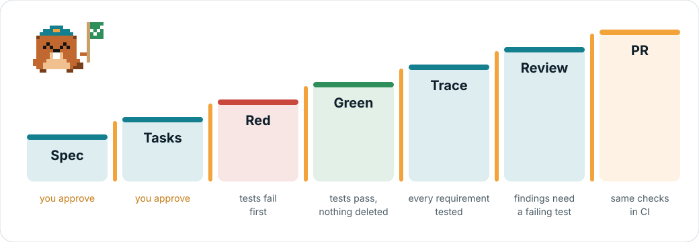

# Getting started

Lockflight runs deterministic checks around a Claude Code agent working in a .NET repository: a guard on every tool call, gates
at the end of a turn and in CI, and — in the standard profile — a spec-driven lifecycle with human approvals and red/green
evidence. This page takes you from nothing to a first green gate.

**On this page:** [Requirements](#requirements) · [Install from source](#install-from-source) ·
[Install on Windows](#install-on-windows) · [Install from a package](#install-from-a-package) · [Lite profile](#lite-profile-target-first-green-in-under-15-minutes) ·
[An existing setup](#a-repository-with-an-existing-claude-code-or-spec-kit-setup) · [Monorepos](#monorepos) ·
[Workspace shells](#workspace-shells) · [Standard profile](#standard-profile) · [CI with a development build](#ci-with-a-development-build) ·
[Levi and the status line](#levi-and-the-status-line)

## Requirements

| For | You need |
|---|---|
| Your machine | macOS (Apple silicon or Intel), Linux (x64 or arm64), or Windows (x64) with [Git for Windows](https://git-scm.com/download/win): Claude Code and the plugin's hooks run under Git Bash. See [Install on Windows](#install-on-windows). |
| The engine | The .NET 10 SDK, plus the SDK your project needs (the engine runs whatever SDK the project's `global.json` pins). git. |
| Claude Code | 2.1.295 or newer: from that version a guard hook that times out blocks the tool call. `doctor` checks it. |
| Your project | SDK-style .NET 8, 9 or 10. .NET Framework projects are not supported. |
| Tests | xUnit v3 (Microsoft.Testing.Platform): everything. xUnit v2 (VSTest), NUnit and MSTest (VSTest, or Microsoft.Testing.Platform with its TRX report): red/green and trace included; tag tests with `[Trait("Requirement", "FR-001")]` (xUnit), `[Property("Requirement", "FR-001")]` (NUnit) or `[TestProperty("Requirement", "FR-001")]` (MSTest). Review reproductions are written as xUnit tests. |
| The `pr` profile's secrets step | [gitleaks](https://github.com/gitleaks/gitleaks) on `PATH` (or `LOCKFLIGHT_GITLEAKS`); without it the step is NOT-EARNED. The generated CI workflow downloads its own. |
| Spec Kit, if you use it (optional in the standard profile) | `uv` and Python 3 with PyYAML. |

## Install from source

To work on Lockflight or try `main`, build the engine from a checkout of this repository and install it for your user; it
needs no package feed and no token. Otherwise, [install from a package](#install-from-a-package). On Windows, see
[Install on Windows](#install-on-windows).

```sh
git clone https://github.com/lockflight/lockflight && cd lockflight
scripts/dev-install.sh            # packs the engine into ~/.lockflight/feed, installs ~/.lockflight/bin/lockflight,
                                  # and installs the plugin at user scope
```

Then set up your project: the [lite profile](#lite-profile-target-first-green-in-under-15-minutes) below.

- **Plugin from the checkout:** the script adds the checkout's development marketplace (`plugins/`, which lists the plugins
  in the checkout) as the `lockflight` marketplace (an existing one, such as the GitHub marketplace, is pointed there), so
  the plugin and the engine come from the same commit. Claude Code reads the plugin from the checkout's folder: a `git pull`
  reaches it at the next session start or `/reload-plugins`, and `lockflight update` pulls it together with the engine. The
  GitHub marketplace serves the last release instead (see [install from a package](#install-from-a-package)). To go back to
  it, remove the development marketplace (Claude Code does not point a folder marketplace back at GitHub, and removing it
  uninstalls its plugins), then add the GitHub one and install again:
  `claude plugin marketplace remove lockflight && claude plugin marketplace add lockflight/lockflight && claude plugin install lockflight@lockflight --scope user`.

- **`lockflight` by name:** the script puts `~/.lockflight/bin` on your `PATH` for new terminals, with one line marked
  `# added by Lockflight: its engine on PATH` in your shell's startup file: `~/.zshrc` for zsh, `~/.bashrc` for bash (and
  `~/.bash_profile` on macOS), `~/.config/fish/conf.d/lockflight.fish` for fish, else `~/.profile`. It prints the file it
  changed; a reinstall or `update` finds the line and adds nothing. Open a new terminal (or `source` that file) to use it.
  `--no-modify-path` leaves your startup files alone; delete the line to undo it.
- **Why user scope:** Claude Code loads project settings only from the directory where a session starts. With the plugin at
  user scope, the guard also runs when you start Claude inside a child repository of a workspace shell. Your own project hooks
  in the shell's `.claude/settings.json` still load only from the shell root.
- **Why `.lockflight/bin/lockflight` instead of `dotnet lockflight`:** `init` links the engine into the project
  (`.lockflight/bin/`, git-ignored). It is the binary the hooks run, a native one, so it runs in projects whose `global.json`
  pins an older SDK. In such a project `dotnet lockflight` cannot run, because only SDK 10 understands the package format.
  Before a project is set up, run the user install, `~/.lockflight/bin/lockflight`.
- **Development versions** are numbered after the last release, so they sort above it and below the next one:
  `0.2.0-alpha.4.dev.<commit time>` after `0.2.0-alpha.4`, `0.2.1-0.dev.<commit time>` after `0.2.0`. Moving a project from a
  development build to the next release is an upgrade; `doctor` reports **development pin** once a release at or above the
  build's base is installed, and `update` moves the project to it.
- **Tool pin:** `init` pins the dev version, which exists only in your local feed. A teammate runs the same script to get it.
  `dotnet lockflight` cannot restore it, so in a linked project run the engine as `.lockflight/bin/lockflight` from the project
  root, as the skills do; `doctor` reports a pin that cannot be restored on this machine. No package feed has it either, so
  CI cannot install it until the project pins a release (`update`).
- **Human decisions** (`approve`, `baseline`, `redgreen reset`, `redgreen amend`, `review dismiss`, `update`) are yours: run them in a separate
  terminal window, not with `!` in Claude Code (that runs inside the session, where they are refused). A spec or tasks
  approval you can also give in the session by typing `/lockflight:approve spec` (or `tasks`), and a baseline, a reset or an
  amend by typing `/lockflight:baseline`, `/lockflight:reset` or `/lockflight:amend`. Each takes two steps: the engine shows
  you what would be recorded under "UserPromptExpansion operation blocked by hook" (not an error), starting with
  `Step 1 of 2`, and ends with the line to type with its code.
- **Updating:** in a separate terminal window (not with `!` in Claude Code), run `~/.lockflight/bin/lockflight update` in a project. An install from source
  (the checkout recorded in `~/.lockflight/source`) pulls your checkout, reinstalls the engine and the plugin, re-pins and links the project and refreshes its `CLAUDE.md` block; commit what it lists. The version follows the
  commit, so nothing changes until the code does. When another project already got the newer engine, Claude Code tells you at
  session start.
- **No token on disk:** the install from source needs no package-feed token. Do not add a package feed with a stored token
  to your NuGet config: any tool or agent that reads the file can print it, and a second package source without a source
  mapping makes `dotnet restore` warn NU1507 in every project with central package management (an error under
  `TreatWarningsAsErrors`).

## Install on Windows

Windows (x64) installs from source with a PowerShell script, into the same layout under your user folder. It needs, besides
the [requirements](#requirements): **Git for Windows** (Git Bash runs the plugin's hooks, as it runs Claude Code's shell
commands) and **Visual Studio Build Tools** with the *Desktop development with C++* workload (the engine is a Native AOT
build). Run it from PowerShell:

```powershell
git clone https://github.com/lockflight/lockflight; cd lockflight
powershell -ExecutionPolicy Bypass -File scripts\dev-install.ps1    # add -NoPlugin for the engine only
```

From Git Bash, `scripts/dev-install.sh` runs the same script. Paths with spaces are fine for the checkout, your user folder
and your projects.

- **What it installs:** the engine at `%USERPROFILE%\.lockflight\bin\lockflight.exe` (with `HOME` set, under `HOME` instead,
  as the engine reads it), the plugin at user scope, and the same feed, `tools\<version>` and `source` as on macOS and Linux.
- **`lockflight` by name:** the script adds `%USERPROFILE%\.lockflight\bin` to your user `PATH` (the per-user environment
  variable, never the system one), once, and says so; open a new terminal to use it. `-NoModifyPath` skips it. To undo it,
  remove the folder from the user variable `Path` in *Environment Variables*.
- **A copy, not a link:** on Windows `bin\lockflight.exe` is a copy of the native engine, and `bin\lockflight.version` records
  its version. Creating a symbolic link needs developer mode or an elevated session, and the launcher that `dotnet tool
  install` puts in a tool path starts the engine from its store, so it is not one file that `link` can copy into a project.
- **Running it:** from PowerShell, `& "$env:USERPROFILE\.lockflight\bin\lockflight.exe" init` in your project, then
  `.lockflight\bin\lockflight.exe doctor`. From Git Bash, `~/.lockflight/bin/lockflight` and `.lockflight/bin/lockflight` work
  as written everywhere in these guides. `doctor` checks that Git Bash is found.
- **Updating:** `lockflight update` works as on macOS and Linux: it pulls the checkout and runs `scripts\dev-install.ps1` again
  (or installs the newest package). Windows does not let a running program be overwritten, so the old engine is renamed
  aside (`lockflight.exe.old-…`) and removed by a later update once nothing runs it.

## Install from a package

`Lockflight.Cli` is published on nuget.org, as a prerelease during the preview. Install the engine for your user, then the
plugin:

```sh
cd ~                                   # outside any project: a global.json there could pick an SDK older than 10
dotnet tool install Lockflight.Cli --prerelease --tool-path ~/.lockflight/bin
~/.lockflight/bin/lockflight version
claude plugin marketplace add lockflight/lockflight
claude plugin install lockflight@lockflight --scope user
```

Then set up your project as below. This install does not change your `PATH`: run the engine as `~/.lockflight/bin/lockflight`,
or add `~/.lockflight/bin` to `PATH` yourself.

- **Release, not `main`:** the marketplace serves each plugin from the latest release tag, at its commit, so the plugin you
  install is the one released with the engine on nuget.org. Changes merged to `main` reach you with the next release; to try
  them earlier, [install from source](#install-from-source).

- **Without the .NET SDK:** [`scripts/install.sh`](../../scripts/install.sh) (macOS and glibc Linux) and
  [`scripts/install.ps1`](../../scripts/install.ps1) (Windows, x64) install the engine from nuget.org with no `dotnet`,
  for a release that publishes its executable hashes (`engine-hashes.json` in the pointer package). Such a release also
  attaches both scripts to its GitHub Release, with their SHA-256 in `SHA256SUMS`:

  ```sh
  sh scripts/install.sh --version <version>          # into ~/.lockflight/tools/<version>; prints the path last
  ```

  ```powershell
  powershell -ExecutionPolicy Bypass -File scripts\install.ps1 -Version <version>
  ```

  The script downloads the platform's package, extracts the executable and compares its SHA-256 with the hash the release
  published, before anything runs it; a mismatch deletes the file and fails. It needs `curl`, one of `unzip`, `bsdtar`,
  `python3` or `perl`, and `sha256sum` or `shasum` (`install.ps1` needs nothing beyond Windows PowerShell 5.1). Alpine (musl)
  is refused: the engine is built for glibc. `LOCKFLIGHT_NUGET_FEED` names another feed (a flat-container base or a v3
  `index.json`, `https://` only), with `LOCKFLIGHT_NUGET_USER` and `LOCKFLIGHT_NUGET_TOKEN` for basic auth (passed to `curl`
  on its standard input, never on its command line); `--via-dotnet [--nuget-config <file>]` fetches through
  `dotnet tool install` for feeds that need a NuGet credential provider, with the same hash check;
  `LOCKFLIGHT_RELEASE_FALLBACK=1` downloads the executable from the GitHub Release instead of the feed. What the check proves:
  the executable is the one the hashes name (integrity), not who built it; the release's build provenance attestation covers
  that (`gh attestation verify`).
- **Why `--tool-path` and not `dotnet tool install --local` in the project:** the engine package is built for each platform,
  and only the .NET 10 SDK can install such a package. In a repository whose `global.json` pins an older SDK, a local tool
  install or `dotnet tool restore` fails. Installed into `~/.lockflight/bin` from your home directory, the engine is a native
  binary that runs whatever SDK the project pins. The project still pins the engine in `dotnet-tools.json`: CI installs that
  version the same way, outside the repository.
- **Updating:** in a separate terminal window (not with `!` in Claude Code), run `~/.lockflight/bin/lockflight update` in a project. It installs the newest
  engine from nuget.org into `~/.lockflight/tools/<version>` (from `~/.lockflight`, outside any project), points
  `~/.lockflight/bin/lockflight` at it, then re-pins and links the project and refreshes its `CLAUDE.md` block; commit what it
  lists. An engine installed as a prerelease follows prereleases. `--source <feed>` replaces the NuGet sources (a mirror, or a
  folder of packages). The plugin updates from its marketplace when a release moves it to a new version: by itself with
  auto-update on for the marketplace (in `/plugin`), or now with `claude plugin update lockflight@lockflight`.
- **Plugin and engine versions:** the plugin names the oldest engine it works with (`min-engine-version` in the plugin). When
  the plugin has updated past the engine a project pins, Claude Code tells you at session start and `doctor` reports
  **plugin engine** as FAIL; `update` fixes both.

## Lite profile (target: first green in under 15 minutes)

The lite profile gives you the guard and the gates, without the lifecycle.

1. At your repository's root, in a terminal:
   ```sh
   cd /path/to/your/repo
   ~/.lockflight/bin/lockflight init      # the user install: the project has no engine of its own yet
   .lockflight/bin/lockflight doctor      # the linked engine, the way the agent runs every command from here on
   ```
   Or ask Claude Code, started at the root: *"Set up Lockflight"*. The `lockflight:init` skill runs the same steps and stops
   where a step is yours.

   `init` writes, and lists what it wrote:
   - `lockflight.yaml`, the manifest (the Stop gate starts off);
   - the tool pin, in the repository's existing tool manifest (`dotnet-tools.json` at the root, or an older
     `.config/dotnet-tools.json`), else a new `dotnet-tools.json`;
   - `.gitignore` entries for Lockflight's local state;
   - `.claude/settings.json`: the Lockflight marketplace and plugin, enabled for the project. Your settings are kept; the file
     is written back as indented JSON. Claude Code reads the marketplace entry (`extraKnownMarketplaces`) only after the folder
     is trusted: a teammate who clones the repository gets the marketplace once they accept the trust dialog, and a `claude -p`
     run in a folder nobody trusted ignores it without a message;
   - `.github/workflows/lockflight-gates.yml`, the CI job. It installs every .NET version the test projects target, and `init`
     says so when there are several. `--ci manual` writes a job that runs only when started by hand, `--ci none` none;
     `--ci-platform azure|bitbucket|gitlab` writes the job for that service instead ([CI on other platforms](ci-other-platforms.md));
   - the linked engine in `.lockflight/bin/` (git-ignored), which the hooks run.

   It merges into files that exist and never overwrites them. Running it again changes nothing.
2. Commit the new files, and start Claude Code at the repository root. From now on:
   - the guard blocks agent edits to protected files (`lockflight.yaml`, the tool pin, `.lockflight/`, Claude settings,
     `Directory.Build.*`, `Directory.Packages.props`, `global.json`, `NuGet.config`, code-style and analyzer config
     (`.editorconfig`, `.globalconfig`, rulesets, `stylecop.json`, `BannedSymbols.txt`), `.gitattributes`, gitleaks config, the gates workflow;
     the full list is in the [configuration reference](configuration.md#built-in-protected-paths));
   - `.lockflight/bin/lockflight gate run` (from the project root; the agent runs the engine this way) runs format → build → tests; `--profile pr` adds vulnerable packages, secrets and — when
     `gates.coverage.collector` is set — patch coverage, as the generated CI workflow does;
   - the Stop gate is **off**; turn it on (`stop.gate: true`) once you know how long build + tests take. It gets at most
     540 s per turn (below the plugin's 600 s Stop hook timeout), whatever `gates.timeoutSeconds` says. Once it is on,
     the ledger records how many Stop gates ran, how many the cache of the last PASS answered, and their time in all.

## A repository with an existing Claude Code or Spec Kit setup

`init` adopts what the repository already has: its own Claude Code setup (hooks, skills, agents, a `CLAUDE.md`), Spec Kit
and existing features. Commit or stash your own changes first, then look at the plan:

```sh
~/.lockflight/bin/lockflight init --dry-run --profile standard   # writes nothing: the files and the adoption plan
```

The plan lists the files init would create or update, what is kept, what becomes protected (the paths your own write-guard
hooks block go to `protected:`), what is flagged (a formatter after edits, a Stop hook that builds, a reviewer agent), the
units it adds and the features it marks as predating Lockflight. Then run the same `init` without `--dry-run`. It keeps your
hooks, skills and agents, protects them from the agent, adds a short Lockflight block to `CLAUDE.md` and merges into
`.claude/settings.json`. It leaves Spec Kit as it is unless you run it yourself, in a separate terminal window, with `--speckit-preset <dir>` (the preset's directory:
`plugins/lockflight/speckit-preset` in the installed plugin or a checkout); then it upgrades Spec Kit with the Lockflight
preset and keeps and lists your customised files. Review `git diff` and commit init's changes as **one commit**: to undo
init, `git revert` that commit. Only the init that creates `lockflight.yaml` marks existing features; a later init does not.

Specs you wrote before adopting Lockflight may fail `phase check specify`. A common reason is a user story with no
Given/When/Then acceptance scenario; others are stories not headed `### User Story N - Title`, requirements not listed as
`- **FR-001**: …`, or template placeholders left in. `lockflight approve` and `/lockflight:approve` run that check
themselves and refuse to approve such a spec, listing what fails. Such a feature needs no approval as long as it stays as it
was when init marked it: `approve verify --base` accepts it until it gets Lockflight records of its own. To bring it under the lifecycle,
add the missing scenarios (or requirements), or rewrite the spec to [the spec contract](spec-contract.md) (Spec Kit's
template, `.specify/templates/spec-template.md`, follows it).
Then run the check until it passes, and approve. `lockflight review` does not need a spec approval: it needs the feature's `spec.md`,
whose requirements it reviews against, and a change to review.

With several feature folders under `specs/`, the engine does not guess which feature you mean. The active feature is the one
named with `--feature <id>`, else the one Spec Kit names: its `SPECIFY_FEATURE_DIRECTORY` variable, the `feature_directory` in
`.specify/feature.json` (a malformed file is an error), its `SPECIFY_FEATURE` variable, or a feature branch such as
`006-weak-spots` or `feat/006-weak-spots`, matched to `specs/006-weak-spots/` by name or by its number. When none names one,
or a branch's number matches several folders, commands stop and ask for `--feature <id>`. See
[the commands reference](commands.md).

## Monorepos

One repository with several services, each with its own solution: `init` at the root lists the child directories that build
on their own (a solution, or a `package.json`) as `units` in `lockflight.yaml`. A root that builds by itself (a solution at
the root) stays one unit.

At the root, `gate run` judges every unit changed since its last PASS, committed or not, and a unit that never passed. A clean
tree after a PASS judges nothing: every unit is N/A (`unchanged since its last PASS`), which is not a green. To judge a unit
anyway:

```sh
.lockflight/bin/lockflight gate run --profile pr --unit services/api                 # every step for that unit
.lockflight/bin/lockflight gate run --profile pr --base origin/main                  # every unit; the branch's changes count
```

The `pr` profile judges every selected unit whatever the cache says, and `--base` makes format, coverage and secrets look at
the branch's changes since the merge base.

## Workspace shells

A workspace shell is a directory whose service repositories are cloned beneath it. Run the same steps at the shell root:

```sh
cd /path/to/your/shell
~/.lockflight/bin/lockflight init --profile standard   # lists the units, ignores the child repositories
~/.lockflight/bin/lockflight workspace sync            # each service repository gets its CI policy
~/.lockflight/bin/lockflight doctor
```

Commit in the shell, and in each service repository after `workspace sync`. Start Claude Code at the shell root. With an
existing setup in the shell, run `init --dry-run` first (see
[above](#a-repository-with-an-existing-claude-code-or-spec-kit-setup)). [CI hardening](ci-hardening.md#workspace-shells-unit-repositories)
describes the unit repositories' CI.

## Standard profile

Everything above, plus the lifecycle. A change climbs it stage by stage, and each gate opens only when its check passes; you
hold the keys to the two approvals.

Each feature is three Markdown files under `specs/<id>/` in a documented format, [the spec contract](spec-contract.md). Who
writes them is your choice, and the checks are the same for all three:

- **the crew** (`/plugin install lockflight-crew@lockflight`): its spec writer and planner write them until the phase checks
  pass; no Spec Kit and no Python needed;
- **Spec Kit** with the Lockflight preset: its `/speckit-*` commands, if your team already uses it or wants it;
- **you**, by hand, or the session with you, following the contract.

Without Spec Kit, `doctor` still reports its Lockflight preset check as failing (and warns about PyYAML) in a standard
project in this release; the lifecycle commands do not depend on either check.

<picture>
  <source media="(prefers-color-scheme: dark)" srcset="../assets/lock-flight-dark.svg">
  
</picture>

1. `~/.lockflight/bin/lockflight init --profile standard` at the repository root. If you want Spec Kit, set it up with the
   Lockflight preset (the init skill does this with you, and `init` prints these lines with the preset's path filled in);
   otherwise skip to the commit and `doctor` at the end of this step:
   ```sh
   uvx --from specify-cli==1.1.3 specify init --here --force --integration claude --script sh
   uvx --from specify-cli==1.1.3 specify preset add --dev <plugin>/speckit-preset
   ```
   `--force` lets Spec Kit initialise a non-empty repository without asking (it merges into existing files). Where Claude Code
   is not on `PATH` (CI, containers), add `--ignore-agent-tools`. `<plugin>` is the installed plugin's directory (under
   `~/.claude/plugins/cache/lockflight/lockflight/<version>/`), or `plugins/lockflight` in your Lockflight checkout; `init`
   and the init skill fill it in for you. The preset replaces Spec Kit's tasks template and appends Lockflight's rules to
   `/speckit-tasks`; `doctor` checks that it is installed. Spec Kit 1.1.3 numbers features sequentially: `specs/001-<slug>/`.
   A repository that already has Spec Kit does not run `specify init` again (it would overwrite customised files): run
   [`init --speckit-preset <dir>`](#a-repository-with-an-existing-claude-code-or-spec-kit-setup), which upgrades it and
   adds the preset. Then commit, and run `.lockflight/bin/lockflight doctor`.
   Before the first feature, accept the tests that already fail: type `/lockflight:baseline tests` in Claude Code, or, in a
   separate terminal window, run `.lockflight/bin/lockflight baseline tests` yourself; then merge
   that baseline in its own pull request first (CI takes baselines from the base branch, so one committed with a feature is
   discarded; see [CI hardening](ci-hardening.md)). Each feature's `redgreen start` then runs the **whole suite once** to
   record the baseline and find tests that already fail — on a large suite that takes minutes (about 3 minutes for ~5,000
   test cases), so expect it and do not interrupt it.
2. Ask Claude to build a feature (the `lockflight:feature` skill). The flow:

   | Step | Who | Check |
   |---|---|---|
   | write `spec.md`: the crew's spec writer, `/speckit-specify` and `/speckit-clarify`, or by hand | agent + you | `lockflight phase check specify` |
   | approve the spec | **you**: type `/lockflight:approve spec` in Claude Code, review what the engine shows, then type the line with its code; or, in a separate terminal window (not `!` in Claude Code), `.lockflight/bin/lockflight approve spec` | hash-bound record |
   | write `plan.md` and `tasks.md`: the crew's planner, `/speckit-plan` and `/speckit-tasks`, or by hand | agent | `lockflight phase check tasks` |
   | approve the tasks | **you**, the same way: `/lockflight:approve tasks`, or `.lockflight/bin/lockflight approve tasks` | hash-bound record |
   | per story: stubs → tests → `redgreen red` → implement → `redgreen green` | agent | red must fail in production code; tests locked until green |
   | a test turns out wrong during red | **you**: `/lockflight:amend <Class.Method> --reason <why>` in Claude Code, or `.lockflight/bin/lockflight redgreen amend` in a separate terminal window | the next `redgreen red` must fail in production code again |
   | `lockflight trace`, `lockflight review`, `gate run --profile pr` | agent | every requirement covered; review findings confirmed by reproductions |
   | PR and merge | **you** | CI runs the same gates with the base branch's policy |

   Approvals are your decision: the agent cannot give them. Inside Claude Code only what you type yourself counts
   (`/lockflight:approve`); the engine refuses `lockflight approve` run from the session, a `!` command included.
   Optional: the `lockflight-crew` plugin adds a spec writer and a planner for the first steps, and a test author that
   writes each story's failing tests at the red step (`/plugin install lockflight-crew@lockflight`). They are an aid; the
   same checks judge their work. See [the crew](skills.md#the-crew-optional).
3. Now and then, with the crew plugin installed, ask for a retro (its `retro` skill) to see recurring incidents and suggested remedies, as advice.

## CI with a development build

The workflow `init` writes installs the engine version the project pins, from nuget.org or the package sources in the
repository's `nuget.config`. A project set up from a package pins a release that nuget.org has, so its workflow runs on every
pull request. An engine built from source is a development build (`0.2.0-alpha.9.dev.<commit time>`) that exists only in
your local feed (`~/.lockflight/feed`), so a workflow that ran on every pull request would fail at the engine install every
time. So:

- When the engine is a development build, `init` writes the workflow to run only when started by hand (`workflow_dispatch`),
  says why in its output, and the workflow's comment says so too. `init --ci pr` writes the pull-request trigger anyway, and
  `init` warns that the job fails until the project pins a published release.
- Run the gates locally in the meantime: `.lockflight/bin/lockflight gate run --profile pr --base origin/main` runs what CI
  would.
- Once the project pins a published release (`update`), replace the workflow's `on:` block with the `pull_request` and
  `push` (`branches: [main]`) triggers, and make `gates` a required check ([CI hardening](ci-hardening.md)).

The workflow installs the engine with `dotnet tool install --tool-path` outside the repository, so it works when the
repository's `global.json` pins SDK 8 or 9.

## Levi and the status line

Levi, the pixel lock-keeper, shows verdicts to you and never to the agent:

|  |  |  |  |
|:---:|:---:|:---:|:---:|
| `PASS` | `NOT-EARNED` | `FAIL` | guard block |

- **In your terminal.** `doctor` and `gate run` draw him with the result: a green flag for `PASS`, a question for
  `NOT-EARNED`, a red flag for `FAIL`. He appears only when a person reads the output. Piped output, `NO_COLOR` and any shell
  Claude Code starts (it sets `CLAUDECODE`) get plain text, so the agent never pays tokens for him. `LOCKFLIGHT_MASCOT=0`
  turns him off.
- **In Claude Code's status line** (optional). `lockflight statusline` prints his face and the last verdict from the local
  ledger, for example `guard blocked **/.env · 2m ago`, `stop gate PASS · just now` or `stop gate FAIL · just now`, or
  `approval waiting: type /lockflight:approve spec <code>` while an in-session code waits for you. The status line is shown to you only
  and costs no tokens. A plugin cannot set it, so add it to your user settings (`~/.claude/settings.json`) yourself, unless
  you already have a status line you want to keep:

  ```json
  {
    "statusLine": { "type": "command", "command": "~/.lockflight/bin/lockflight statusline", "refreshInterval": 5 }
  }
  ```

  Outside a Lockflight project it prints nothing. Where managed settings set `allowManagedHooksOnly`, Claude Code reads
  `statusLine` only from the managed file, so the line has to go there (see
  [team policy in managed settings](guardrails-and-boundaries.md#team-policy-in-managed-settings)).

  To keep a status line of your own, call `lockflight statusline` from your script with the same stdin and place its two
  lines next to yours. If your script runs `git status`, prefix it with `GIT_OPTIONAL_LOCKS=0`: a status line runs after
  every assistant message, and a plain `git status` briefly takes `index.lock`, which can make the agent's `git commit` fail.

## Next

- [Configuration reference](configuration.md): `lockflight.yaml`, gate profiles and protected paths
- [Guardrails and boundaries](guardrails-and-boundaries.md): what Lockflight can and cannot guarantee
- [CI hardening](ci-hardening.md): CODEOWNERS and required checks
- [CI on other platforms](ci-other-platforms.md): Azure Pipelines, Bitbucket Pipelines and GitLab CI/CD
- [Code quality](code-quality.md): the recommended analyzers, code metrics rules and architecture tests `init` can add
