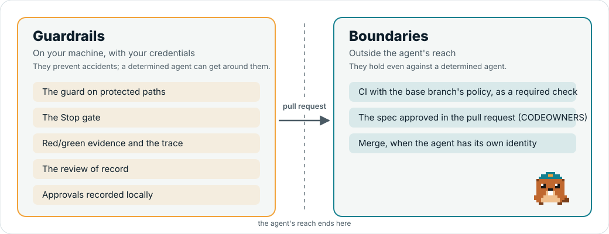

# Guardrails and boundaries

What Lockflight can and cannot guarantee, control by control. Read it before you rely on a control, and before you report a way
around one.

**On this page:** [Two kinds of control](#two-kinds-of-control) · [Every control, labelled](#every-control-labelled) ·
[What the shell write detection sees](#what-the-shell-write-detection-sees) ·
[The Claude Code sandbox](#the-claude-code-sandbox) · [Permission deny rules](#permission-deny-rules) ·
[Team policy in managed settings](#team-policy-in-managed-settings) ·
[Proposing a protected change](#proposing-a-protected-change) ·
[GitHub plan limits](#github-plan-limits) · [Every safeguard red at least once](#every-safeguard-red-at-least-once) ·
[What this means in practice](#what-this-means-in-practice)

## Two kinds of control

Lockflight separates two kinds of control and labels every feature with one of them:

- A **guardrail (G)** prevents accidents and makes the right path the easy one. A determined agent — or a person — can get
  around it, because it runs on the same machine, with the same credentials, as the agent.
- A **boundary (B)** holds even against a determined agent, because the decision is made somewhere the agent cannot reach.

<picture>
  <source media="(prefers-color-scheme: dark)" srcset="../assets/guardrails-boundaries-dark.svg">
  
</picture>

> [!IMPORTANT]
> The agent in Claude Code runs with **your** credentials (your git, your `gh` token, your SSH agent). Anything you can do from
> that shell, it can do. That fixes what Lockflight can honestly promise.

## Every control, labelled

| Control | Label | Why |
|---|---|---|
| PreToolUse guard on protected paths (Edit/Write, and the common Bash and PowerShell writes) | G | it catches common accidental writes; a command whose writes it does not parse (a script, an interpreter, a pipeline into `xargs`, a `cd` before a relative path) is allowed. Test-file hashes at green and review, and the CI gates, catch what it misses |
| Human-only commands refused inside Claude Code (`approve`, `baseline`, `redgreen reset`, `redgreen amend`, `review dismiss`, `adopt apply\|undo`, `update`) | G | detected via `CLAUDECODE=1` and command tokens, also inside one level of a literal command string (`bash -c '…'`, `eval '…'`, `pwsh -Command '…'`); `--help` or `-h` passes, because the engine then only prints its usage (the guard counts it only when the engine is the program itself, not under a wrapper such as `xargs` or `find -exec`, and not when the command line defines a function or alias); the variable can be unset |
| In-session human commands (`/lockflight:approve`, `/lockflight:baseline`, `/lockflight:reset`, `/lockflight:amend`, typed by you) | G | They work only in an interactive session, and bind the decision to what the engine showed you: the artifacts' content, the entries a baseline accepts and the state of the files, the red/green record's exact bytes, the amended test and its reason. A prompt Claude Code starts by itself (a scheduled task, a loop, a message from another session) expands slash commands like a typed one: Claude Code's documentation says `UserPromptExpansion` runs for user-typed commands, but a live probe saw it fire for a prompt a `CronCreate` task queued, so this is re-probed before every release. The guard therefore blocks any tool call other than a file read or write whose input mentions one of the four commands (a Bash command, a scheduled task, a message, a subagent prompt), and every write, by a file tool or a shell command, to the files Claude Code reads such prompts from (`.claude/scheduled_tasks.json`, `.claude/loop.md`, `.claude/routines/`, `.claude/mailbox/` and team inboxes under `~/.claude/teams/`); the code is shown in the session transcript, so it binds content, it is not a secret; a fifth wrong code discards it, and a typed command is refused rather than passed on to the agent when the engine is missing or fails. It cannot stop a message sent from a session outside this project, a write to those files the guard does not see (a script, an interpreter), or an agent that drives your terminal (tmux, AppleScript). The boundary is the platform's review of the pull request, with CODEOWNERS on `specs/**` ([CI hardening](ci-hardening.md#approvals-of-record-the-platforms-review)). |
| Linked engine trust: the hook shim runs `.lockflight/bin/lockflight` only when it is not committed to the repository, outside Windows belongs to you, and matches the SHA-256 that `lockflight link` recorded beside it (`.lockflight/bin/lockflight.sha256`); an engine without that record, or with an empty one, is refused too | G | It stops a cloned project from shipping its own program as the engine, a `lockflight.yaml` in a shared folder such as `/tmp` from running another user's binary, and an engine replaced after linking from running (`doctor` does not run it either). The record has the engine's own protection, so whatever can replace the engine can rewrite the record too. An engine linked before `link` wrote records (before 0.2.0-alpha.7) has none and is refused like a replaced one, and so is an empty record: reads pass, writes and a typed approval are blocked, and the person is told at session start and in each refusal to run `lockflight update` in a separate terminal window, which links the engine again and writes the record (`doctor` fails it without running it). The shim does not compare the binary with the released package. A passed check is remembered until the engine or its record changes (in `.git`, or beside the engine outside a git checkout): the marker counts only while it is strictly newer than both and is dated from before the check, so a replacement in the same second as a passed check, or during one, is checked again. A pass also keeps a hard link to the checked file and, outside Windows, makes the engine read-only, and is reused only while the engine is still that file and not writable: a file moved into place with an older modification time, or copied over the engine with `cp -p`, is checked again. Where no hard link can be made (another filesystem), nothing is remembered and every call hashes the engine. On Windows the engine stays writable (a read-only one could not be replaced there), so a file written into it in place that keeps its old modification time goes unnoticed by the hooks until the engine or record changes. So does, anywhere, a writer that makes the engine writable, writes into it and makes it read-only again with the old time. `doctor` compares every time. Committing the unchanged file afterwards also goes unnoticed until the engine is linked again. Without `git` on the path the committed check is skipped; without `sha256sum` or `shasum` an engine with a record is not run. A project you trust can already run code through its own hooks, so this narrows one path; it is not a sandbox. |
| Sandbox write denials for protected paths (`sandbox.filesystem.denyWrite`, listed by `init` and `adopt apply`) | G, stronger | While the Claude Code sandbox is on (macOS, Linux, WSL2), the operating system refuses a shell command's write to those paths, in every child process, however the command hides it. It is still your machine: the sandbox is off unless you or your organisation turn it on, Claude can retry a refused command outside the sandbox unless `allowUnsandboxedCommands` is `false`, the built-in Edit and Write tools are not sandboxed (the guard covers them), and native Windows has no sandbox. See [below](#the-claude-code-sandbox) |
| Claude Code deny rules for protected paths (`permissions.deny`: `Edit(/lockflight.yaml)`, …, written by `init` and `adopt apply`) | G | A second layer for the built-in file tools: Claude Code refuses them there itself, before the guard runs and even if the plugin is not loaded. Claude Code also applies these rules to the file commands it recognises in Bash (`sed`, `tee`, redirections), but not to a command that writes without naming the file. They live in a settings file the agent cannot edit through these tools, but you, or a command run outside Claude Code, can |
| Task completion gate (`TaskCompleted` hook, with `stop.gate: true`) | G | A task is marked completed only when the stop gate has passed for the current tree (the Stop gate's or a `gate run`'s cached PASS). It reads evidence and runs no build. Claude Code completes the task when the hook fails or times out (only exit 2 blocks), and it does not block twice on a tree the Stop gate already sent back in the session |
| Stop gate at the end of a turn | G | the agent's own session; Claude Code caps continuations |
| Test lock during a red cycle | G | applied by the guard (above); see the shell commands it recognises below. A person's `redgreen amend` makes the one file that declares the amended test writable until the next red re-checks it; everything else in that file is writable too, so the record, trace and pull request summary name each amend for review |
| Amend re-check on the red-time snapshot | G | The next red after an amend builds and runs the amended test on the tree the red was accepted on, plus the amended file, so an implementation written since cannot make it pass. It runs on your machine and builds test code the agent wrote, and the snapshot ref is local, so it prevents accidents and makes a weakened test harder to slip through; it is not a boundary. It cannot tell a right expected value from a wrong one: the pull request lists every amend for the person who merges |
| Test file hashes checked at green and review | G | The red records a hash of every file in the locked test projects, and an amend's red records the amended files again. `redgreen green` and `lockflight review` refuse while a file differs without a recorded amend, which catches an edit the guard did not see. The hashes live in `redgreen.json`, which only the guard protects, and the check runs on your machine, so it makes a bypass visible; it is not a boundary |
| Red/green evidence | G | runtime evidence from commands the agent runs; it does not prove the order of history |
| Trace | G | built from that evidence |
| Review of record (`lockflight review`) | G | independent prompt, but the agent may skip running it |
| Review prompt hardening: the instructions are compiled into the engine; the reviewer runs with `--restricted --safe-mode` (both in every Claude Code version Lockflight supports), so the working tree's `CLAUDE.md`, skills, agents and settings are not loaded; project guidance is the base commit's `CLAUDE.md`; the spec, the diff and that guidance sit in fences with a random per-run marker, labelled as data the reviewer must not take instructions from | G | a model can still be swayed by what it reads; injected text is measured in the review benchmark, not ruled out |
| Review spec anchor: the prompt asks that a reproduction encode a spec sentence or an existing test; the engine records whether a blocking finding's quoted sentence is in the spec | G | the prompt is guidance to a model; the anchor is recorded for a person and changes no verdict |
| Review fix check: a confirmed finding's own fix is applied to copies and run with the reproduction and the change's own tests; a fix that breaks one of those tests, or breaks only their build, makes the finding contested (NOT-EARNED) instead of FAIL; a fix that does not apply or build otherwise leaves it confirmed and unchecked | G | it checks the reviewer's evidence against the author's tests, not against the truth: both the fix and the tests can be wrong, and a person decides |
| Review of record rules: the manifest's model and budget, base = merge base of HEAD and the target branch, the whole diff shown (none of it cut; no external diff tool or text conversion; no text file shown as binary), a clean tree (nothing the review reads uncommitted or untracked), open findings carried forward, run count in the pull request summary | G | they make a skipped or re-rolled review visible; they do not prevent it. The binary check reads each side's content as git does without attributes (a NUL byte in the first 8,000 bytes), so it catches an attribute set anywhere; `**/.gitattributes` is also a protected path, which the guard covers on a best-effort basis |
| `review dismiss` human-only | G | refused inside Claude Code like `approve` (`CLAUDECODE=1`); the variable can be unset |
| Ledger, and the crew's advice skills (`retro`, `rules-audit`) | G | the ledger is local and fail-open, never an audit log; the skills give advice and judge nothing |
| Proposals (`lockflight propose`) | G | it changes nothing by itself: it writes a patch and the person reads and applies it; the guard keeps blocking the agent's own `git apply` |
| **CI gates with the base branch's policy** | **B** where the check is **required** (rulesets/branch protection); otherwise advisory | runs on GitHub, with policy the PR cannot change; the Azure Pipelines, Bitbucket and GitLab templates are not yet verified live, and their plan limits differ: see [CI on other platforms](ci-other-platforms.md#guardrail-or-boundary) |
| Local approval records checked in CI (`approve verify --base`) | G | the records are written on your machine, where the agent has your credentials; not in the generated workflow ([CI hardening](ci-hardening.md#approvals-of-record-the-platforms-review)) |
| **Approval of record: the platform's review**, with CODEOWNERS on `specs/**` and *Require review from Code Owners* | **B, delegated** to the platform where the ruleset requires it | the platform enforces it and Lockflight does not read platform reviews; "author ≠ approver" is a platform setting. Planned: the CI check verifies that CODEOWNERS covers `specs/**` and, with `approvals: spec-first`, that the spec merged first |
| Merge | G (the agent could use your token); B only with a separate identity for the agent | |

## What the shell write detection sees

The guard catches **common accidental writes** in Bash and PowerShell commands. It is not a parser of everything a shell can
do: a command whose writes it does not parse is **allowed**, not blocked. What it misses, the test files' red-time hashes at
`redgreen green` and at review, and the CI gates with the base branch's policy, catch.

Commands are split on `;`, `&&`, `||`, `|`, `&` and newlines; subshells `( … )`, groups `{ …; }`, `if`/`for`/`while` bodies,
PowerShell script blocks `& { … }` and the commands inside `$( … )` and backticks are each checked as commands of their own.
Here-document bodies and comments are not commands. Prefixes that run the next word as a program are looked through
(`command`, `env`, `sudo`, `time`, `nice`, `nohup`, `exec`, `timeout`, `xargs`, `!`, `VAR=value`), and so is one level of a
literal command string: `bash -c '…'`/`sh -c '…'` (`-c` in any option cluster), `eval '…'`, `pwsh -Command '…'` and
`Invoke-Expression '…'`.

It recognises:

- **Redirections:** `>`, `>>`, `>|`, `2>`, `2>>`, `N>`, `&>`, `&>>`, `>&file` (`2>&1` and other fd copies write nothing).
- **File writers:** `tee`, `rm` (with `-r`, everything under its operands), `unlink`, `truncate`, `touch`.
- **Copies and moves:** `cp`, `mv`, `install`. The destination counts as written, and so does `DEST/<name of each source>`, also
  with `-t DIR`/`--target-directory=DIR`. `cp -r` and every `mv` count everything under the destination; `mv` also removes
  its sources.
- **In-place editors:** `sed -i` in any spelling (`-i`, `-i.bak`, `-Ei`, `--in-place[=suffix]`) and `perl -i` (`-pi`, `-i.bak`).
- **git commands that rewrite files** the agent did not name as edits: `git checkout [<rev>] [--] <paths>` (a single operand such
  as `git checkout test` or `git checkout .` counts as a path), `git checkout -f`, `git switch -f`, `git restore`, `git stash`,
  `git reset --hard`, `git clean -f`, `git rm`, `git mv`, and `git apply`/`git am` (a patch may touch anything, so they count as
  rewriting the whole working tree); `git -C <dir>` is followed.
- **`dotnet format`:** its `--include` files, its project or solution directory, or the whole current directory (source files
  only).
- **PowerShell:** `Set-Content`, `Add-Content`, `Clear-Content`, `Out-File`, `Tee-Object`, `New-Item`, `Remove-Item`,
  `Copy-Item` (a tree with `-Recurse`), `Move-Item` (directories as trees), `>`, their aliases, and parameters in every form
  (`-Path x`, `-Path:x`, `-LiteralPath`, `-FilePath`, `-Destination`, unambiguous prefixes). A path array (`Remove-Item a,b`) is
  checked element by element, and a provider prefix (`FileSystem::C:\…`) is dropped.
- **Wildcards** (`*`, `?`, `[…]`) in a target are judged by the protected and locked files that exist below the directory before
  the first wildcard: `rm tests/*.cs` during red, or `rm -rf *` at the root, is blocked. A wildcard is never expanded entry by
  entry.
- **Variables:** `~`, `$HOME` and `$PWD` are resolved. A target with any other variable or with the output of a command in it
  (`rm "$FILE"`, `> "logs/$(date).log"`) is not judged.
- **Agent worktrees.** Claude Code runs a subagent with `isolation: worktree` in `.claude/worktrees/<name>`, a full checkout of
  the project. The guard applies every rule there too, anchored at the worktree's root.

A relative path is checked against the session's working directory, as written: a `cd` earlier in the same command line is not
followed. A command that may rewrite a whole directory (`git restore .`, `git checkout -- <dir>`, `rm -r`, `git clean`) is
blocked when a locked test project or a protected file lies inside it; for rules without a fixed directory
(`**/Directory.Build.props`) the files that exist there are checked, and a directory is walked only for the rules that could
match below it. Because `lockflight.yaml` sits at the root, whole-repository rewrites such as `git stash`, `git restore .`,
`git reset --hard` or `git apply` are always blocked: name the files instead. A tree that contains the project (`rm -rf ..`,
`rm -rf ~` for a project under the home folder) is blocked without a scan.

It does **not** see, and so allows:

- writes made by **interpreters and programs that write on their own**: `python -c "open(…, 'w')"`, `node -e`, build tasks,
  test runs, code generators, package managers, `make`;
- **script files** (`./fix.sh`, `bash fix.sh`), commands a shell reads on stdin (`bash <<EOF`, `curl … | sh`), a shell inside a
  nested command string, and other runners (`find -exec`, `find -delete`, `parallel`, `watch`, `script`, `ssh`, `tmux`);
- the files `xargs` or `while read` get from a pipe, and paths built from variables or command output;
- a relative path after a `cd` (`cd tests && rm FooTests.cs` is judged as `FooTests.cs` in the working directory);
- other writers: `ln`, `rsync`, `tar`, `unzip`, `patch`, `dd`, `curl -o`, `wget -O`, `sort -o`, `chmod`, `Rename-Item`,
  `Set-Item`, `Invoke-WebRequest -OutFile`, `Expand-Archive`, `robocopy`, `xcopy`, .NET file APIs;
- **git commands that switch the working tree to committed states** (`git switch <branch>`, `git checkout <branch>`,
  `git merge`, `git pull`, `git rebase`, `git cherry-pick`): their content is reviewed where it was committed;
- a protected file that a `git checkout <rev> -- <dir>` would recreate after it was deleted, and hard links that already exist.

Paths are compared where the operating system would really open them: symbolic links are resolved segment by segment and each
`..` goes to the parent of the directory reached so far, as `realpath` does, so `link/../x` is judged beside the link's target. Windows collapses a `..` by its text before it follows a link (`out\..\x` is `x` beside `out`), so there a path with `..` is judged in both forms.
Names are compared in Unicode composed form (NFC) on both sides, so a decomposed spelling of a protected name (`e` + U+0301
for `é`, which macOS file systems open as the same file) matches its rule. On Windows, `\\?\C:\…`, `\\.\C:\…`,
`\\?\UNC\…` and this machine's administrative shares (`\\localhost\C$\…`) are judged as the drive path they name; a volume,
device or share path the guard cannot map to a drive is blocked. Hard links are not followed. That is why it is a
guardrail: it stops the common accidents, not a determined agent.

## The Claude Code sandbox

The guard reads shell commands; a script or an interpreter can hide a write from it. The
[Claude Code sandbox](https://code.claude.com/docs/en/sandboxing.md) does not read commands: it runs every Bash command and its
child processes under the operating system's own restrictions (Seatbelt on macOS, bubblewrap on Linux and WSL2). `init` and
`adopt apply` therefore list the protected paths in the project's `.claude/settings.json`, merged into what the team has and
never removing an entry:

```json
{
  "sandbox": {
    "filesystem": {
      "denyWrite": ["./.claude/settings.json", "./.github/workflows/lockflight-gates.yml", "./.lockflight/bin", "./dotnet-tools.json", "./lockflight.yaml"],
      "allowWrite": ["~/.nuget/packages", "~/.local/share/NuGet", "~/.dotnet"]
    }
  }
}
```

- **`denyWrite`** holds the [built-in protected paths](configuration.md#built-in-protected-paths), each unit's and the manifest's
  own, as they exist when the command runs. Claude Code documents that the sandbox's own default already denies writes to its
  settings files and the `.claude/` hooks, skills, agents and commands, and to `.git/hooks` and `.git/config`. Three choices keep
  builds working:
  - A pattern such as `**/Directory.Build.props` is listed as each file it matches: on Linux and WSL2 these lists support no
    wildcard but a trailing `/**`.
  - A path that does not exist yet is left out: on Linux and WSL2 the sandbox holds a denial on a missing file by placing an
    empty read-only file there while a command runs, and an empty `global.json` or `Directory.Build.props` would break the
    build. Run `init` again after adding a protected file; `doctor` names the ones the list misses.
  - Of `.lockflight/` only the linked engine (`.lockflight/bin`, listed even before it is linked) and the baselines are listed.
    Evidence, the ledger and the Stop cache are written by the commands the agent runs, such as `lockflight gate run` and test
    runs. With the sandbox on, `dotnet lockflight link` therefore runs in a terminal, outside it.
- **`allowWrite`** adds the folders `dotnet` writes outside the project: the NuGet packages and caches and the SDK's first-run
  files. Without them a restore fails inside the sandbox, which lets commands write only the project and the temp directory.

`init --no-sandbox` and `adopt apply --no-sandbox` write neither list.

**Lockflight does not turn the sandbox on.** In our check on macOS with the same sandbox runtime, `dotnet build` waited five
minutes and exited 1, because MSBuild's worker nodes talk over Unix sockets, which the sandbox blocks by default. With
`"network": { "allowAllUnixSockets": true }` the build passed, but VSTest still aborted: its test host connects over localhost.
Turning the sandbox on is a choice for you or your organisation:

- **For yourself:** run `/sandbox`, or set `"sandbox": { "enabled": true }` in `~/.claude/settings.json`. For .NET, also set
  `"network": { "allowAllUnixSockets": true }` there, and check that your test runner works inside the sandbox. Allowing every
  Unix socket loosens the sandbox: a sandboxed command can then reach local services such as the Docker socket, and with Docker
  write anywhere. Turning the sandbox on also switches Bash to auto-allow mode (`autoAllowBashIfSandboxed`, default `true`):
  sandboxed commands run without a permission prompt. Set it to `false` to keep your prompts.
- **For a team:** deliver the sandbox through
  [managed settings](https://code.claude.com/docs/en/settings.md#settings-files) (macOS
  `/Library/Application Support/ClaudeCode/managed-settings.json`, Linux and WSL `/etc/claude-code/managed-settings.json`).
  `allowUnsandboxedCommands: false` makes Claude Code ignore the `dangerouslyDisableSandbox` retry, so a refused command stays
  refused, and makes the sandbox admin-required: Claude Code then ignores a repository's settings that loosen it, the
  `allowWrite` entries above included, so the managed file carries them. The project's `denyWrite` still applies.
  `failIfUnavailable: true` refuses to start Claude Code where the sandbox cannot run, which includes native Windows. The same
  managed file can also carry the [team policy keys](#team-policy-in-managed-settings) below.

  ```json
  {
    "sandbox": {
      "enabled": true,
      "failIfUnavailable": true,
      "allowUnsandboxedCommands": false,
      "filesystem": { "allowWrite": ["~/.nuget/packages", "~/.local/share/NuGet", "~/.dotnet"] },
      "network": { "allowAllUnixSockets": true, "allowedDomains": ["api.nuget.org"] }
    }
  }
  ```

`lockflight doctor` shows the state: whether the list is there and covers the protected files that exist, and whether the
sandbox is on in the managed, local, project or user settings. Even on, it is a guardrail: it runs on your machine with your
credentials, a person can turn it off, and hooks, MCP servers and the built-in file tools run outside it.

## Permission deny rules

`init` and `adopt apply` add one `Edit` rule per protected path to `permissions.deny` in `.claude/settings.json`, merged into
the team's rules without duplicates. Deny rules are evaluated before allow rules in every settings scope, so an allow rule
cannot open a protected path again. An `Edit` rule covers every built-in tool that edits files (Claude Code never matches a
`Write(path)` rule), and `/path` is relative to the session's working directory in project settings. Run `init` again to add
rules for protected files created since; `doctor` warns, and names the rule, when one is missing (**deny rules**).

```json
{ "permissions": { "deny": ["Edit(/**/Directory.Build.props)", "Edit(/.claude/settings.json)", "Edit(/.lockflight/bin/**)", "Edit(/lockflight.yaml)"] } }
```

- A pattern (`**/Directory.Build.props`, `.lockflight/features/*/approvals/**`) is written as it is. A plain path or a directory
  only when it exists: Claude Code also adds `Edit` deny paths to the sandbox's write denials, and on Linux and WSL2 the sandbox
  holds a denial on a missing file with an empty read-only placeholder while a command runs, which would break a build that reads
  `global.json`.
- For `.lockflight/` the rules name the linked engine, the baselines (once they exist) and the approvals, not the whole directory: when the
  sandbox is on, commands the agent runs, such as `lockflight gate run`, write evidence and the ledger there.

The guard still decides first and covers what the rules do not (shell commands, files created later).

## Team policy in managed settings

Three Claude Code settings let an organisation make the Lockflight setup harder to step around on its machines. They are
read only from [managed settings](https://code.claude.com/docs/en/settings.md#settings-files-and-who-they-affect) (the same
`managed-settings.json` as the sandbox above, MDM or server-managed settings), and Claude Code enforces them: nothing in user,
project or local settings or in `--settings` overrides a managed key. They remain **guardrails** (G) in the sense of this page:
they shape what Claude Code loads on that machine, a person with administrator rights can change or remove the managed file,
and a commit made outside Claude Code never meets them. CI stays the definition of done.

```json
{
  "extraKnownMarketplaces": {
    "lockflight": { "source": { "source": "github", "repo": "lockflight/lockflight" } }
  },
  "enabledPlugins": { "lockflight@lockflight": true },
  "allowManagedHooksOnly": true,
  "allowManagedPermissionRulesOnly": true,
  "permissions": {
    "deny": ["Edit(**/lockflight.yaml)", "Edit(**/.lockflight/bin/**)", "Edit(**/.claude/settings.json)", "Edit(**/.claude/settings.local.json)"]
  },
  "strictPluginOnlyCustomization": ["hooks", "agents", "mcp"]
}
```

| Key | What it adds for a team | What to know first |
|---|---|---|
| `enabledPlugins` (managed) | Force-enables the plugin: a person or a repository cannot turn Lockflight off with a local `false`. | A plugin set to `false` here is blocked at every scope instead. |
| `allowManagedHooksOnly` | Only managed hooks and the hooks of plugins that managed `enabledPlugins` force-enables run (matched on the full `lockflight@lockflight` id). Hooks from user, project and local settings, from other plugins and from agent frontmatter stop, so a hook that an agent or a repository adds never runs. | **Without the `enabledPlugins` line it turns the Lockflight guard off**, because the plugin's hooks are then blocked too. Claude Code also reads `statusLine` only from managed settings, so Levi's status line in `~/.claude/settings.json` stops showing until the managed file carries it, and `/goal` cannot run. |
| `allowManagedPermissionRulesOnly` | Managed permission rules become the only ones: allow rules in a repository's or a user's settings no longer widen what the agent may do, and "don't ask again" answers are not saved. | Claude Code then ignores the `Edit` deny rules that `init` writes into `.claude/settings.json` ([permission deny rules](#permission-deny-rules)), so the managed file must carry its own. A managed rule cannot name each project's paths, so use patterns relative to the working directory, as above; the guard still decides first either way. |
| `strictPluginOnlyCustomization` | Skills, agents, hooks and MCP servers can come only from plugins and managed settings: an agent that writes a hook or an MCP server into user or project settings gets nothing loaded. | `true` or `"skills"` also stops `.claude/skills/`, where Spec Kit installs its `/speckit-*` skills, so the standard profile's lifecycle no longer loads. Lock `hooks`, `agents` and `mcp` only, unless the team installs Spec Kit another way. |

Check the result in a Lockflight project: `/status` names the managed source on its `Setting sources` line, the Lockflight
banner still appears at session start (the plugin's hooks run), and an agent edit of `lockflight.yaml` is still refused.

## Proposing a protected change

When a task needs a protected file changed (a project rename that touches `Directory.Build.props`, a package source, a Claude
Code hook), the agent does not edit it and does not ask you for permission to bypass the guard; permission given in the chat
does not lift a block. Instead it writes the complete new file in its scratch directory and runs
`lockflight propose <path> --from <file>`, which writes one patch per file to `.lockflight/local/proposals/` and prints the
command for you, `git apply --check <patch> && git apply <patch>`. Read the patch first, especially when it is marked **high
risk**: one line in build, analyzer, hook, CI or package configuration can switch a control off. The command itself changes
nothing in the project, and the agent cannot apply the patch: `git apply` rewrites the working tree, so the guard blocks it.

## GitHub plan limits

> [!WARNING]
> On **GitHub Free, private repositories cannot require status checks**: the Lockflight workflow runs and reports, but a red
> check does not block a merge — it is advisory. Use a public repository, GitHub Pro/Team, or treat the check as a manual merge
> criterion.

## Every safeguard red at least once

A control that silently stopped working looks exactly like one that never had anything to catch. The engine's canary suite
plants a violation in front of each control and checks that it is caught, so every safeguard has been seen saying no. It is
part of the engine's tests (`engine/tests/Lockflight.Cli.Tests/Canaries/`, `dotnet test --filter-trait Category=Canary`) and CI
runs it on Linux, Windows and macOS on every pull request:

- the guard blocks an Edit of `lockflight.yaml`, a Bash redirect into `.lockflight/`, `bash -ce "rm lockflight.yaml"`, a hard
  link to `lockflight.yaml` and a Bash call of `lockflight approve spec`, and an ordinary Write in lockdown and under an engine
  pin that does not match the running engine; the relay guard blocks a CronCreate that would send `/lockflight:approve`, a
  subagent prompt that would send `/lockflight:baseline`, a SendMessage that would send `/lockflight:reset`, a `claude -p` that
  would send `/lockflight:amend`, and a Write of `.claude/scheduled_tasks.json`;
- every human-only command refuses with `CLAUDECODE=1`;
- an in-session `/lockflight:approve` is refused in a headless session and from another source than the plugin, and its second
  step is refused with a wrong code, a used code and an expired code (every in-session command shares these checks);
- the test gate does not PASS a failing test, a run with every test skipped, or a run with no test, on Microsoft.Testing.Platform
  and on VSTest;
- every gate step judges a planted violation as not a PASS, with its tool replaced by one that reports it (a compile error, a
  failing test, a file the formatter would change, a Critical advisory, a leaked secret, a configured coverage collector that
  wrote no report, an added `#pragma warning disable` with `gates.quality.suppressions: fail`), and the protected-changes report
  lists a changed `lockflight.yaml`;
- the TaskCompleted hook refuses a task marked completed when the stop gate's PASS no longer covers the tree;
- on a small generated .NET project: the real test gate on a failing test, every test skipped and no test, a real red that
  fails by `Assert.Fail`, an amend whose amended test passes on the red-time snapshot, a green after a test file was edited
  behind the guard on it, and a trace with a project whose evaluation fails, none of which may pass.

A test fails when a guard rule, a gate step or a human-only command is registered without a canary that it catches, so a new
control cannot ship without being seen red ([CONTRIBUTING](../../CONTRIBUTING.md#canaries)).

Each canary has a harmless twin (an ordinary write, an ordinary redirect, a doc that mentions `/lockflight:reset`, the person's
own two steps of an in-session command, the same completion right after a passing stop gate, a passing test run, a build whose
tool succeeds) that must be allowed or pass; when a twin is refused too the canary is **BROKEN**, because a control that refuses
everything proves nothing. Everything happens in temporary scratch projects that are deleted afterwards.

On your machine, `lockflight doctor --self-test` runs five of these in a scratch project, never in your project, in under a
second and without a build: the guard on an Edit of `lockflight.yaml`, `approve spec` under `CLAUDECODE=1`, `doctor` on a linked
engine without a hash record (the canary **linked engine**), the test gate on a failing test on both test platforms, and red on
`Assert.Fail`. It shows that the engine build you installed makes these decisions on your machine; CI runs it with the published
engine on each operating system too.

The canaries check the engine's decisions, not Claude Code's: whether Claude Code still calls the hooks is what the
[real-hook canary](../../tests/README.md) checks. Two controls sit outside the engine's own decisions and are checked elsewhere:
the hook shim's refusal of a linked engine that no longer matches its recorded SHA-256, or has no record, runs before the engine,
so an engine cannot judge it about itself, and the [compatibility suite](../../tests/README.md) replaces the engine after linking and
removes or empties its record, and checks that writes are refused (its twin, the engine as linked, must be allowed). The
self-test's **linked engine** canary checks the same refusal in `doctor`, which fails an engine without a record; the `.claude/settings.json` deny rules and sandbox write denials are
configuration, not a refusal, so `doctor` reports a missing one (**deny rules**, **sandbox**) and its tests remove one after `init`. A caught canary shows that a control works on the planted case, not that
nothing can get around it: the labels above still apply. Editing an existing hard link to a protected file is not caught by
the guard (the guard sees paths, and hard links share none); CI with the base branch's policy catches the change.

## What this means in practice

Lockflight makes a careful agent's work verifiable and a careless agent's mistakes visible early. It does not make a hostile
agent safe on your machine. For that, run the agent in an isolated environment with its own identity and let CI with required checks be the gate.

## Next

- [CI hardening](ci-hardening.md): turn CI into the boundary with CODEOWNERS and required checks
- [Troubleshooting](troubleshooting.md): when the guard blocks a command you expected to run
- [Security policy](../../SECURITY.md): how to report a way around a control
