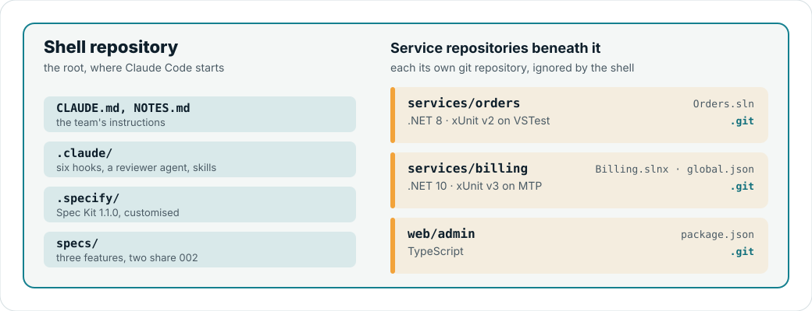

# Sample: workspace shell

A synthetic workspace shell for testing Lockflight's workspace support and adoption of an existing setup: a root repository
with a team's own Claude Code and Spec Kit setup, and three service repositories beneath it. Nothing here comes from a real
project.

<picture>
  <source media="(prefers-color-scheme: dark)" srcset="../../docs/assets/workspace-shell-dark.svg">
  
</picture>

## What is in it

- `shell/`: the root repository, with the team's own setup.
  - `CLAUDE.md` and `NOTES.md`.
  - `.claude/` with six team hooks: session notes, a protected-file guard, a contracts guard, a commit/push confirmation, a
    format-on-edit and a Stop build check. It also holds a reviewer agent, a custom skill and the stock Spec Kit 1.1.0
    skills.
  - `.specify/`: Spec Kit 1.1.0, with a customised constitution and plan template.
  - `specs/`: three existing features; `002-billing-retry` and `002-invoice-pdf` share a number.
- `children/`: the service repositories.

| Path | Stack | Solution | Global SDK pin |
|---|---|---|---|
| `services/orders` | .NET 8, xUnit v2 on VSTest, coverlet.collector | `Orders.sln` | none |
| `services/billing` | .NET 10, xUnit v3 on MTP | `Billing.slnx` | `global.json` |
| `web/admin` | TypeScript | — | — |

## Materialize it

Make it real git repositories (the shell ignores `services/` and `web/`):

```sh
tests/workspace/make-shell.sh "$(mktemp -d)/acme"
```

The script copies `shell/` to the destination and makes it a git repository, then copies each child beneath it as a
repository of its own. [`tests/workspace/gates.sh`](../../tests/workspace/gates.sh) and
[`tests/workspace/lifecycle.sh`](../../tests/workspace/lifecycle.sh) build their workspace with it.

## Credits

The `.specify/` folder and the `speckit-*` skills were generated by [Spec Kit](https://github.com/github/spec-kit) 1.1.0
(MIT, Copyright GitHub, Inc.), unchanged except the constitution and one line in the plan template.
